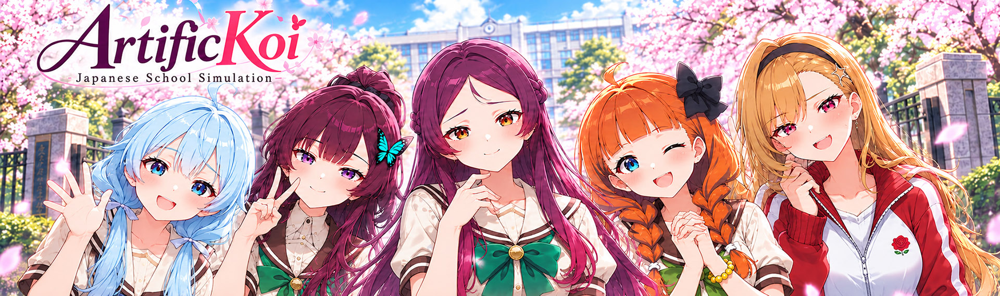
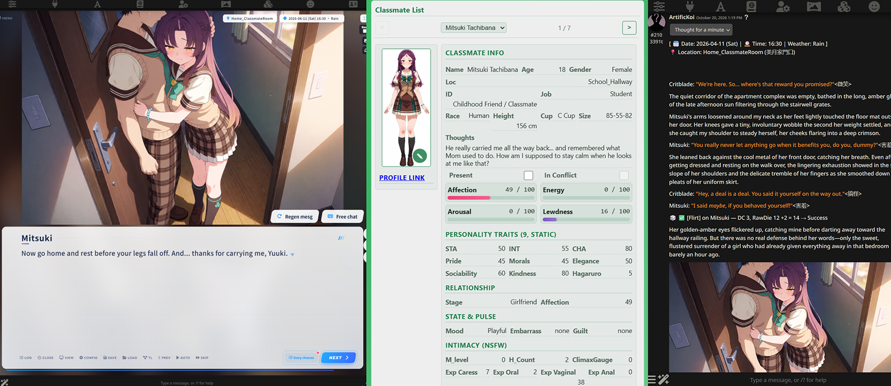
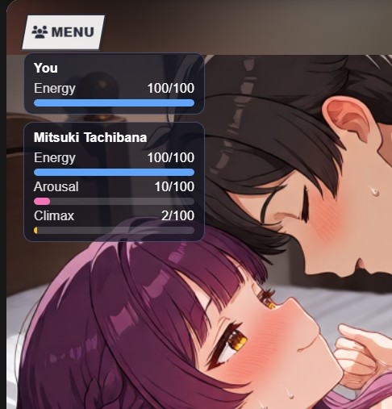

# ArtificKoi

## Installation guide

ArtificKoi rides on numerous extension to pull off the trick.  It needs MVU Helper, plus the 2 SillyTavern extensions MVU Helper rides on, Tavern Helper and ST-Prompt-Template. There's also one setting you must not skip, Environmental isolation. Then you import the card. It's 7 short steps, all on [Install ArtificKoi](doc/install.md).

## Requirements

ArtificKoi needs a model that can handle it, a few SillyTavern settings, and ComfyUI with a good video card if you want the pictures. It's all on [Requirements](doc/requirements.md).

## Start the game

After you import the card, you just need to setup your initial stats.  You have 200 points to allocate into 4 different stats. STR and INT will help you in school events and STA will grant you extra move per time block, while CHA will make you dating girl easier.  You can increase stats in the game later on, just like a RPG game. Then you can start the game by clicking into the Galgame GUI or just chat on Sillytavern.  The Quest section of the status menu will guide you how to survive the first day of school.

## What is ArtificKoi

ArtificKoi is a love simulation game set in a Japanese school. It tries to copy some of the game mechanics of the well known eroge Koikatsu, by Illusion.  **It runs right inside Sillytavern!**  The game can be displayed in both a galgame GUI, or display in the traditional Sillytavern format.  
I believe it won't play like any Sillytavern character card you have played before because there are game mechanics, game contents as well as events inside the character card.  Because the game logic engine is coded, it can do a LOT more than what a preset or feeding instruction to LLM can do.
  
It is implemented based on [MVU Game Engine v2.0](https://github.com/KritBlade/mvu-helper/blob/main/doc/gamelogic_engine/README.md), and that engine never sends a formula, a table or a whole engine to the LLM. The AI writes the story the same way it would with no game engine at all. At the end of each reply, it just reports what happened in the scene, and that's all it has to do.  Anyone can use the same framework to [vibecode your own game engine](https://github.com/KritBlade/mvu-helper/blob/main/doc/gamelogic_engine/README.md).  Moreover, it comes with a Status Menu GUI which track stats for each characters.   The status menu works in both [image generation](https://github.com/KritBlade/mvu-helper/blob/main/doc/image_gen/README.md) mode and plain text mode.

All the real work behind the game mechanics happens in the JavaScript game engine: the dice, the Affection, the clock, the events and the sex scenes. That keeps the prompt simple and dynamic, and the numbers right every single time.  This is the trick to enable local model can also run on it.

You play Mainchar, and you live 3 years of school life at 人光学園 (Jinko Academy), in 人光市 (Jinko City), a Japan-like world. Students start the academy at  the age of 18 and graduate at 21.  You are the only male student in the academy who just moved back to Jinko City from Osaka after 6 years.

There are 21 heroines, each with her own personality archetype, plus 1 secret character from the [Artific Realm](https://github.com/KritBlade/ArtificRealm).

The card starts you with one heroine already at your side, your lifelong friend **Mitsuki Tachibana**. She's the bright, warm classmate who appointed herself your guide, and she eases you into the opening. Past her, there's no fixed plot. Every other girl joins the game the moment you meet her, and the engine tracks her from then on.

- **The world runs on a real calendar.** The school year follows the Japanese April to March cycle, on the real 2026 to 2029 calendar. Weekdays are school days: homeroom, classes, lunch and after school. Weekends are free days for dates around town. The big set pieces happen on their real dates: the Entrance Ceremony, the Sports Festival, the Cultural Festival, the School Trip and Graduation. At graduation, the world time-leaps back to year 1, but every bond and every memory carries over. (Game+)
- **Heroines are real characters who remember.** Every heroine you meet goes into the record as a Classmate in MVU variables. She has her own 9 personality traits, an Affection and a relationship stage that shift as you play, a live Mood and Arousal, a secret, hobbies, and her own timeline of what happened between you. Each one is tracked on her own, so a harem works too.
- **Outcomes are earned, not narrated.** Flirting, confessing and getting physical are all D20 social checks against a DC the engine sets, and the AI can't change it. A failed approach stays failed. The AI can't soften a rejection into a secret yes. How the dice work is on [True deterministic D20](https://github.com/KritBlade/mvu-helper#true-deterministic-d20).
- **Everything stays on the map.** Every scene happens in a real location, on campus, in town, in the outskirts or at home, so [the world](https://raw.githubusercontent.com/KritBlade/ArtificKoi/refs/heads/main/Image/school_map.jpg) stays consistent.

## Your school day, block by block

Unlike a regular Sillytavern chat, a school day is cut into 4 blocks of time to mimic how Koikatsu works.

| Block | Time |
|---|---|
| Morning | 07:30 to 11:59 |
| Lunch and afternoon | 12:00 to 15:59 |
| After class | 16:00 to 18:59 |
| Evening | 19:00 to 23:59 |

Every reply is one move. Mainchar's STA decides how many moves you get in each block: STA divided by 10, and never fewer than 3. STA 30 gives you 3 moves per block, STA 50 gives you 5, and STA 80 gives you 8.  You can adjust how many STA points on character creation, but you only have 200 points to allocate for 4 stats, STR, STA, INT and CHA.  STR and INT will help you on different event day, STA will give you more moves while CHA will give bonus on DC roll.

When your moves run out, the clock jumps to the next block. After the evening block, the day ends and the next morning starts.   On a regular school day, you might want to plan how you should use your move in each block because you can't do much within a block of time, you will want to strategically plan what you should do within a limited number of moves. 

Say your STA is 30. You chat with Mitsuki before homeroom, pass a note in class, and help a classmate carry books to the library. That's 3 replies, and the bell rings for lunch.

Weekends, holidays and event days have no such limit. You play them as long as you want, and the day ends when you sleep.   So, make sure you make use of the free move on those days.   You can also check the "Next-Block" checkbox, then your next reply will jump to the next block of time.

Training raises Mainchar's own stats. Physical training raises STR or STA, studying raises INT, and taking care of yourself, a haircut, skincare, a clean uniform, raises CHA. A session gives 1 to 3 points, depending on how hard you went at it. The more STA you build, the more move you fit into one school day.   (You just need to prose you are training with whoever heroine, the system will pick up the hint)

Each kind of training counts once a week. Study 3 times in one week, and only the first session raises your INT. A run and a study session in the same week both count.

The first day of school serves as a tutorial so there is no limit on the move.  The real game start on the 2nd day.  However, it does have a sequence of triggered event that you have to complete.  That's a test if the AI model you are using is up for the task.

## The 9 traits of every heroine

Every heroine profiles are [here](doc/heroines.md).

Every heroine has 9 traits, each from 0 to 100. They're part of who she is, so they never change. Together they decide how she treats Mainchar, and how hard she is to win.

When a trait is very high or very low, it shapes what she likes. Every trait but Morals works this way. Approach her the way she likes, and that check gets easier. Go against it, and that check gets harder.

Say she has very high Elegance. Walk her home and hold the door with good manners, and that check is easier. Tell her a dirty joke, and that check is harder.   All these are **coded** in the game logic engine so the game mechanics ALWAYS stick.

- **Sta (Stamina).** How sporty and physical she is. A sporty girl likes active dates, and a low-energy one likes it cozy. A sporty girl also cares about your STR. A strong Mainchar wins her more easily, a weak one has a harder time.
- **Int (Intelligence).** How smart she is. A smart girl wants you to respect her mind, and cares about your INT the same way. With a girl who isn't, keep it simple.
- **Cha (Charisma).** Her own charm and presence. A very charming girl wants you to match her energy. A very plain one wants it gentle, just the 2 of you.
- **Pride.** How proud she is. A proud girl wants you to prove your worth, and her praise is rare. A humble one needs reassurance. In a fight, a proud girl comes at you to have it out, instead of going quiet.
- **Morals.** How strict she is about intimacy. This one has its own job. The higher it is, the harder every intimate step gets, and a strict girl warms up slower the first time.
- **Elegance.** How refined she is. A very elegant girl wants good manners and tasteful places. A very low one wants it casual and earthy, no pretension.
- **Sociability.** How outgoing she is. An outgoing girl is a bit easier on every check, and comes to you on her own more often. A reserved one is harder on every check, rarely comes to you, and won't reach out at all until she likes you, so you'll have to go to her.
- **Kindness.** How kind she is. A kind girl likes seeing you be kind to others. In a fight, she may come to you and apologize first.
- **Hagaruro.** How scheming she is, the sweet face with a dark side. A schemer likes it when you play along. A girl with none of it wants plain sincerity. A schemer you're dating doesn't forgive being ignored. Leave her alone too long, and she spreads rumors about you, other girls like you less, and she picks a fight with you.

## The relationship ladder

Every heroine sits on a ladder: Stranger > Acquaintance > Friend > Dating > Girlfriend.

Each stage has its own Affection, from 0 to 100. Fill it up, and she moves up one step by herself. Her Affection then starts again from 0, for the new stage.

The last step is yours to take. To go from Dating to Girlfriend, you have to confess, and win the check.

The higher she is on the ladder, the easier every check gets. With an average CHA, a first kiss needs a 19 or higher on the die from a Stranger, and a 13 or higher once you're Dating.

She can fall back too. Betray her, and she drops one step, her Affection goes to 0, and the 2 of you are in a fight.

There are special routes off the ladder too, like Friends with Benefits. How to get there is for you to find out.  There are numerous game mechanics in the game.

## The initiative system

The heroines don't just wait for you. They reach out to you on their own, without you cueing them.

This is not the simple countdown a preset uses, where a timer runs out and somebody comes to talk to you. Every reply, the game engine checks every heroine: her relationship stage, how much she likes you, her personality traits, whether you're fighting, and how long it's been since she last reached out.

What she does depends on how close you are. A girl who barely knows you says hi, or saves you a seat. As she warms up, she invites you to something she's into, then flirts with you, then confides in you. Only once you're dating does she reach for your hand or hug you. A girl who likes you enough can reach into your day even when she's not in the scene.

How often she does it depends on her personality. An outgoing girl reaches out often, and comes back to you sooner. A reserved one rarely does, and won't at all until she likes you.

A fight changes everything. A girl you're fighting with doesn't greet you like nothing happened. A proud, outgoing or scheming girl may come at you to have it out. A kind girl, or one who still likes you a lot, may come to apologize. A girl who is none of those just goes quiet, and her silence is her answer.

The engine works out who may reach out this reply, and the PRE call picks from that list. PRE is told to pick 1 girl most replies, often nobody, and 2 at the most. Her mood counts too: an excited girl is more forward, and a sad or angry one holds back. Then the narrator writes it in her own voice.

Who is allowed to reach out, and what she's allowed to do, is coded in the JavaScript engine, so those rules hold 100% of the time. The AI only picks from the girls the engine allows.

## Sex scenes, the battleground

A sex scene is a game of its own, with **a lot of game mechanics** behind it. The moment one starts, meters show up on the screen: your Energy, and her Energy, Arousal and Climax.  

Every sex act costs Energy, yours and hers. At the start, with no experience, hers drains fast.

Arousal is what saves her Energy. The more aroused she is, the less each act costs her. Foreplay builds Arousal and costs no Energy at all, so skip it, and the scene burns out fast. After she climaxes, she has to be warmed up again.  Since this is a Sillytavern game, you can type whatever you like how to prose.  The narrate will pick up if your action is a foreplay or not. 

She gets better with practice. Each kind of act builds its own experience, caressing, oral, vaginal and anal. The more experience she has with an act, the less Energy it costs her.  

There are also a lot of different sex positions in the game, from the basic ones to the acrobatic ones. You don't pick them from a list. Just write the position in your own words, and the game recognizes which one it is.

The harder the position, the more experience she needs for it. With little experience, a hard position can fail: she slips back to an easier one, and it costs her some Energy. Once she has enough experience, it just works. The hardest one, where you lift her up and carry her, needs your STR too.

The Climax meter fills with every sex act. When it hits the top, she climaxes. Back off just before the top, and you edge her. **Edge her a few times, and the release is much bigger.**

When her Energy hits 0, she's exhausted. Just like in Koikatsu, that's not the end of the scene. She falls into an **ahegao** state, and stays in it as long as the scene goes on. Push a girl who isn't ready that far, and she won't thank you for it.

## Events and heroine quests

Every heroine has her own quest, a chain of events that tells her story one step at a time. Mitsuki's is called "Next Door, Always".

Each event has conditions: a place, a time, who's with you, how much she likes you. When they all match, the event triggers by itself, and the narrator plays it. You don't pick it from a menu. You just live your school life, and the story finds you.

Say Mitsuki is with you at the karaoke place on a free day, and she likes you enough. Then her karaoke event plays, and it's her story, not a random scene. On a school day, or with a girl who barely knows you, nothing happens.

There are more than 250 events in the game. That's every heroine's quest, plus the story events on the calendar, like the festivals and the school trip.  I hand made those events to better shape how I want to deliver 'who she is'.  Every heroine have their strenght and weakness, it's not a random NPC generated by AI.  This is game contents.

## The school year

Every year follows the real Japanese school calendar, and the big days happen on their real dates. Each one is a set piece with its own story steps.

On a set piece day, the step you're on shows up as your objective. This is event trigger.  You can still go wherever you want. The narrator will prompt you toward the next step until you are ready.  Technically, you don't need to complete an event, but most event give big bonus to selected heroine.

Many of these days end with a bonus. The girl you spent the day with likes you more. On the exam, the Sports Festival and the Cultural Festival, a die and your stats decide how well you did.

Long breaks don't make you play every single day. The game picks a few days from each break and skips the rest.  

What each year holds:

- **Entrance Ceremony.** Day 1. You find your class, meet your homeroom teacher and get your seat. Your seat neighbor matters, you'll sit beside her every day. Then the class introduces itself, and the girls start to become people.  It's a tutorial, no limit on moves.
- **Golden Week.** The first long holiday, and your first real chance at a planned date. The amusement park, the zoo, the aquarium, a picnic.
- **Term exams.** Twice a year. A week before, Mitsuki reminds you to start studying. Studying raises your INT, and your INT decides how the exam goes. Do well, and the smart girls are impressed. Fail, and it's remedial classes.
- **Summer break.** The beach, the pool, the summer festival, fireworks on the riverbank, a test of courage at night.
- **Obon.** 2 days in August. Yukata, the bon dance and fireworks on the first night. Floating lanterns down the river on the second.
- **Sports Festival.** Red team against white team, the three-legged race and the class relay. Your STR decides how you do. A week before, Mitsuki asks which events you'll enter.
- **Cultural Festival.** A week before, the class votes on what to run: a maid cafe, a haunted house, a play or a food stall. On the day, your CHA decides how the booth does. It ends with the bonfire dance, and they say a couple who dance there stay together.
- **School Trip.** In your 2nd and 3rd year. A week before, the teacher names where you're going. Then 4 days away, with a free afternoon to spend with one girl, a hot spring, and whatever the room gets up to after lights-out.
- **Christmas and New Year.** Christmas Eve is the couples' night, with the winter lights and the gift exchange. New Year's Eve has the countdown, and New Year's Day the first shrine visit.
- **Valentine's Day.** The girls give you chocolate, and which chocolate says everything: true feelings, friendship, or just obligation. The game decides who gives you what from how close each girl is to you.
- **White Day.** A month later, it's your turn to give back. Who you give to, and what, tells them how you feel.
- **Graduation.** The last day. A girl who asks for the second button of your uniform is confessing. Then the world leaps back to year 1, and everyone remembers.

## Make your own events

Want more story? As a content creator, you can make your own events in MVU Status Menu Builder > **Event Pack** tab.

No coding is needed. You upload the ArtificKoi card, then pick each event's conditions and effects from drop-down menus. The builder only offers what ArtificKoi allows, with the real places and the real heroines. How it works is on [Build events in MVU Status Menu Builder](https://github.com/KritBlade/mvu-helper/blob/main/doc/eventpack_engine/builder.md).

## Make your own plugin for the game!

The game engine also allow 3rd party dev to vibecode addon for the game.  There is a dedicated plugin page in MVU-Helper to allow user to install plugins. For example, you can create a weather plugin for the game.  The weather in the story will changed based on the weather plugin.  Moreover, the plugin system is generic enough that a lot of plugin can be installed into any game card that built on the MVU Game Engine v2.0 and it works without coding change.  Then, you can distribute it to other users without asking the author of the card to change 1 line of code.

## Multiple LLM calls

Since ArtificKoi built on MVU Game Engine v2.0, it inherits the multi LLM call feature.  It uses more than 1 LLM call so that it will offload some easy but tedious tasks to cheaper AI models.  For example, you can offload image generation to a secondary LLM call instead of using your main expensive model.

## Credits

The galgame GUI frontend in ArtificKoi is [galgame](https://github.com/bigmalove/galgame), by bigmalove. It's a visual novel plugin for SillyTavern, and it draws the whole screen: the backdrop, the text box, one line at a time. I didn't build that part.

My [galgame-companion](https://github.com/KritBlade/galgame-companion) only makes it work with MVU Helper and translates it into English. So, big thanks to bigmalove.
