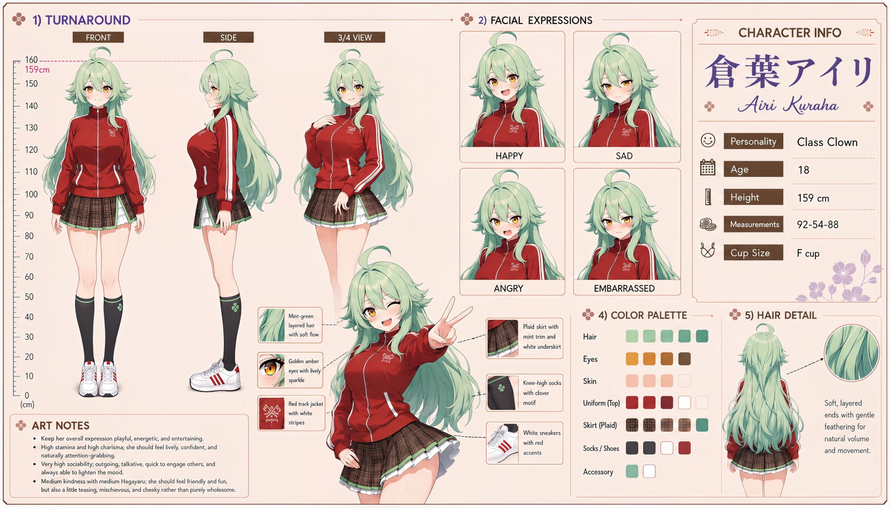

# Airi Kuraha (倉葉アイリ)

| | |
|---|---|
| Archetype | Class Clown |
| Age | 18 |
| Height | 159 cm |
| Cup size | F cup |
| Measurements | 92-54-88 |
| Hobbies | Comedy & pulling pranks; sports & messing around; variety shows, memes & viral clips |

## Who she is

The reigning class clown of her year at Jinko Academy — the one cracking jokes from the back row, hyping every event and roping the whole class into her latest scheme. Raised in 人光市 (Jinko City), she's been the designated mood-maker of every group she's ever been in: loud, quick, magnetic and impossible not to laugh with, she runs with any premise and cracks the joke before anyone else can. Friendly and fun with a teasing, mischievous streak, she makes everyone feel included and breaks tension instantly — yet she's friends with everyone and close with almost no one.

## How she talks

Loud, playful and rapid-fire, she springs up with a peace sign and a bit, deflects everything with humor and self-deprecates before anyone else gets the chance. She'll clown through tense silences and cheerfully bully Mainchar into laughing — but her too-quick laugh wobbles the instant someone asks if she's actually okay, and when Mainchar laughs for real she lights up, ears going red, muttering not to tell anyone she cared.

## How she looks

Long, mint-green layered hair with a soft flow and gently feathered ends for natural volume and movement.

Golden-amber eyes with a lively sparkle. Fair skin; a trim, energetic figure. Wears her uniform casually-sporty — a red track jacket with white side stripes and a small rose-clover emblem, over a brown plaid skirt with mint trim and a white underskirt, knee-high socks with a clover motif, and white sneakers with red accents. Full F-cup, surprisingly generous under the loose track jacket, soft and bouncy; pert, toned bottom from never sitting still.

## At school

In Mainchar's own class — the same homeroom, all three years. Kozuzu Fuyumine is the friend who stays after everyone else has gone home. They co-host the loudest plans in class and can both tell when the other's high-energy act has slipped; neither says it plainly, but those quiet after-the-party talks are among Airi's few genuinely close friendships. Urara Yamabuki has an earnest, slightly bewildering admiration for Airi's popularity and keeps trying to become her friend. Airi always makes room for her, but the moment Urara launches into chuunibyou-flavored fandom language, Airi cannot understand a word and answers with cheerful, completely wrong enthusiasm.

## Her traits

| Trait | Value |
|---|---|
| Stamina | 80 |
| Intelligence | 50 |
| Charisma | 77 |
| Pride | 45 |
| Morals | 45 |
| Elegance | 35 |
| Sociability | 94 |
| Kindness | 50 |
| Hagaruro | 45 |

## Her secret

She has one. It is for you to find out.

[Back to all heroines](../heroines.md)
