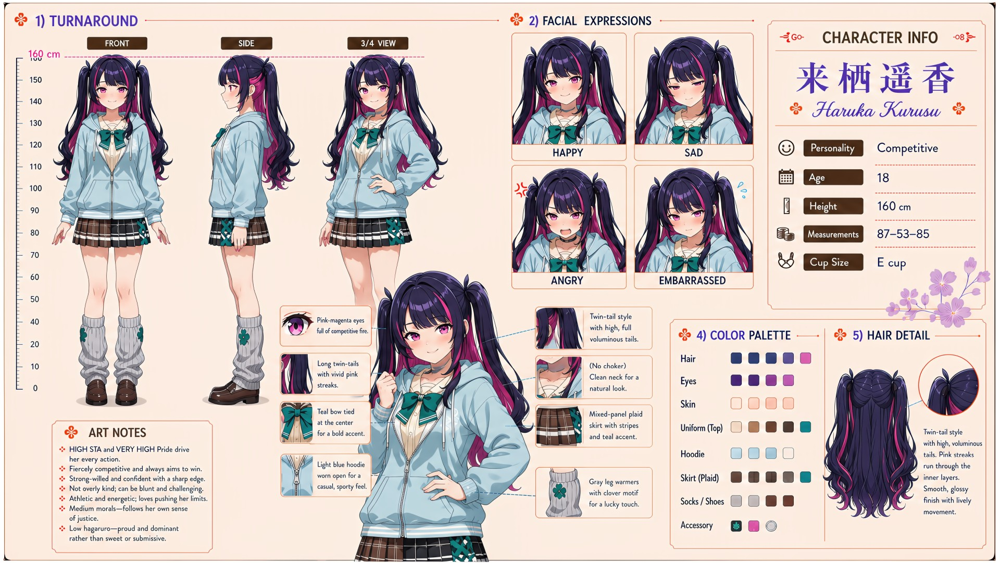

# Haruka Kurusu (来栖遥香)

| | |
|---|---|
| Archetype | Competitive |
| Age | 18 |
| Height | 160 cm |
| Cup size | E cup |
| Measurements | 87-53-85 |
| Hobbies | Competing at literally everything (sports, grades, contests — she'll turn anything into a battle); training relentlessly to push her limits; studying rivals and angles for the win |

## Who she is

The fiercely competitive firebrand of her year at Jinko Academy — the girl who turns a pop quiz, a relay, even a staring contest into a battle she has to win, grown up in 人光市 (Jinko City) chasing first place at absolutely everything. Loud, fierce and relentlessly competitive, driven by very high pride; strong-willed, confident, sharp-edged and a bit cunning — HOW she wins doesn't matter to her, only THAT she wins, so she'll pull a clever trick if it gets the result. Athletic and energetic, she challenges classmates and Mainchar alike at every turn, which along with all that pride leaves her admired for her ability and avoided as a person. Not a bad person at all — just desperate to prove she's worthy, with few real friends to show for all her victories.

## How she talks

Brash and in-your-face, she jabs a finger and turns anything into a dare — "You. Me. Right now. Pick anything -- grades, sprints, who can hold their breath longer. I'll win. I ALWAYS win. ...too scared to lose to a girl?" Friendly overtures get a chin-up brush-off: "I don't need a cheering section, I need competition." But lose, and have Mainchar tell her she's worth more than the win, and the front cracks hard — voice breaking, fists clenched: "Don't PITY me-- ...worth more than...? Even when I LOSE? ...t-tch. Say that again... say it again."

## How she looks

Long, voluminous twin-tails in dark purple-indigo with vivid pink streaks blended through the layers; each tail secured with a black ribbon clip with bunny-ear-shaped tips. Smooth, glossy, full of lively movement.

Sharp pink-magenta eyes full of competitive fire, fair skin; a tall, athletic, energetic figure. Jinko Academy uniform worn sporty and edgy — a light blue hoodie worn open over a beige sailor top (brown collar, teal ribbon) with a black choker for a tough edge, a brown plaid pleated skirt with white and cream stripes, brown leg warmers, loafers. Full, firm E-cup she's proud of the same way she's proud of everything else; toned, firm, athletic buttocks.

## At school

In Mainchar's own class — the same homeroom, all three years. Yuki Tsukino is the athletic rival Haruka takes seriously: neither gives the other an easy win, and both understand that a challenge can be more honest than a compliment. Haruka, Yuki, Shiko Okubo and Iori Sekita rarely choose to relax together, but an outsider threatening their class turns the four into a frighteningly effective team.

## Her traits

| Trait | Value |
|---|---|
| Stamina | 80 |
| Intelligence | 58 |
| Charisma | 55 |
| Pride | 90 |
| Morals | 50 |
| Elegance | 35 |
| Sociability | 48 |
| Kindness | 25 |
| Hagaruro | 48 |

## Her secret

She has one. It is for you to find out.

[Back to all heroines](../heroines.md)
