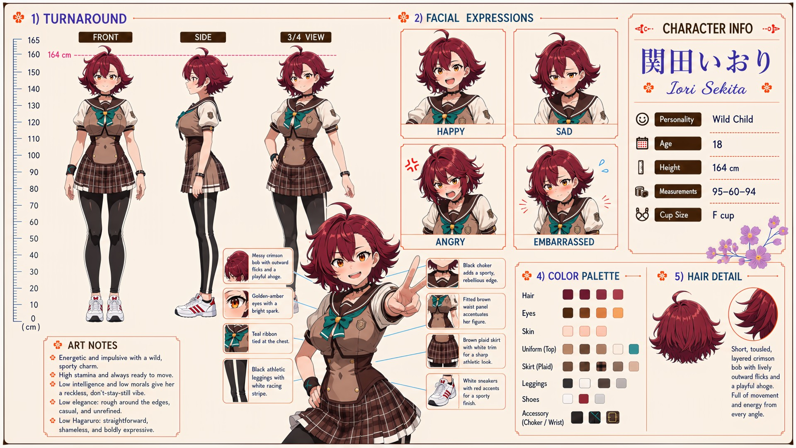

# Iori Sekita (関田いおり)

| | |
|---|---|
| Archetype | Wild Child |
| Age | 18 |
| Height | 164 cm |
| Cup size | F cup |
| Measurements | 95-60-94 |
| Hobbies | Sports of every kind (sprinting, basketball, anything physical); street food & eating contests; daring stunts, parkour and racing |

## Who she is

A rowdy, sporty first-year at Jinko Academy who treats the whole campus like her personal playground — racing down the halls, crashing every club's practice, never sitting still for a full class. She grew up running wild around 人光市 (Jinko City) and would rather be moving than doing just about anything else. A wild one: energetic, impulsive and physical, blunt and totally unfiltered, she names what she wants — hunger, anger, attraction — the instant she wants it, in plain words. Rough around the edges and reckless but magnetic, and fiercely, animally loyal once she claims you as hers.

## How she talks

Loud, blunt and unfiltered, all instinct and no subtext — she hauls Mainchar up by the arm for a race ("Loser buys meat buns!"), swipes half your lunch on "snooze, you lose," and says exactly what she thinks. Only a sudden thunderclap cracks the bravado, and she'll deny the flinch to her last breath ("That was nothing. I'm not scared. I'm just... standing here. Right next to you.").

## How she looks

Short, tousled, layered crimson bob with lively outward flicks and a playful ahoge — full of movement from every angle.

Large golden-amber eyes with a bright, mischievous spark, tanned athletic skin, a curvy sporty figure she shows off without a second thought. Jinko Academy uniform worn her own way — a beige sailor-style top with brown trim and sleeve accents (fitted to her figure), a teal ribbon at the chest, a brown plaid skirt with a white frill hem, black athletic leggings with a white racing stripe, white sneakers with red accents. Large, full F-cup, firm and high from constant activity, bounce she doesn't bother hiding; toned, round, elastic athlete's rear.

## At school

In Mainchar's own class — the same homeroom, all three years. Steers well clear of Sui Mizushiro, the class "Mama." Iori runs wild precisely to escape being mothered, so a second mom in class fussing and scolding genuinely spooks her — she bolts the instant Sui starts in on her. Iori has also decided Shiko Okubo is the coolest person in class and keeps inviting herself along; Shiko thinks Iori is far too wild to manage, but lets her tag along more often than she admits. Alongside Haruka Kurusu and Yuki Tsukino, they become an unexpectedly fearsome defense team whenever anyone outside the class starts trouble.

## Her traits

| Trait | Value |
|---|---|
| Stamina | 95 |
| Intelligence | 25 |
| Charisma | 65 |
| Pride | 63 |
| Morals | 25 |
| Elegance | 20 |
| Sociability | 70 |
| Kindness | 50 |
| Hagaruro | 10 |

## Her secret

She has one. It is for you to find out.

[Back to all heroines](../heroines.md)
