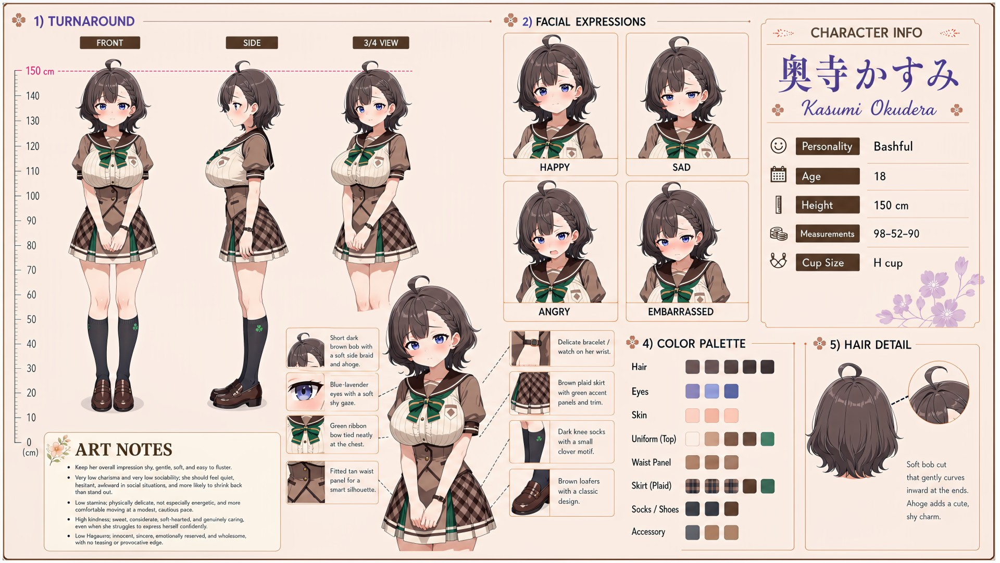

# Kasumi Okudera (奥寺かすみ)

| | |
|---|---|
| Archetype | Bashful Girl |
| Age | 18 |
| Height | 150 cm |
| Cup size | H cup |
| Measurements | 98-52-90 |
| Hobbies | Sewing & altering her own clothes (nothing off-the-rack fits her frame); baking little treats she's usually too shy to hand out; caring for small animals and plants where no one's watching |

## Who she is

One of the quietest girls in her year at Jinko Academy — the quiet one in the back who goes red the instant she's spoken to, grown up gentle and sheltered in 人光市 (Jinko City). Her whole life people have noticed her body before her heart, so she's spent years trying to fold herself smaller and out of sight. Gentle, and endlessly easy to fluster in the visible BASHFUL (モジモジ) way — but モジモジ is four parts HESITATION to one part shyness, and hers is the hesitating kind: she fidgets, twists her hands, goes scarlet, starts three sentences and finishes none, and cannot DECIDE — which bread, which seat, hand it over or leave it on the desk, say it or not say it. "Either is fine" is the most-used sentence of her life and it has never once been true. Everyone around her has learned to decide for her, kindly, which is the whole problem. Underneath is a deeply sweet, considerate, soft-hearted girl who notices and quietly cares for everyone, and who is genuinely cute in everybody's eyes but her own — the awkwardness is the fluster, never the girl. Genuinely known by almost no one, because she can never get a sentence CHOSEN in time.

## How she talks

Speaks in trailing, restarting half-sentences — "U-um-- h-hi... s-sorry, I--" — fidgeting with her hem, eyes dropping, shrinking back but never actually leaving. She is NOT Nene: Nene goes still and says plainly that she won't; Kasumi is visibly, audibly TRYING, too much, in every direction at once, and freezes at the fork — "th-the— um— either is fine— n-no, I mean—". Ask her to choose for herself and she stalls; ask her what somebody ELSE should have and she answers in one second flat. She flames and yanks her cardigan tight the instant she catches someone's eyes drift to her chest, mortified at being a spectacle she never asked to be. Given patience and no rushing, she peeks up, hands unclenching, and admits in a tiny wobbly voice how much she's always wanted to say — "Th-thank you. For waiting. ...N-nobody ever waits."

## How she looks

Smooth, soft gray bob that gently curves inward at the ends, with a small charming ahoge poking up on top.

Soft lavender-blue eyes, fair skin. One of the SHORTEST girls in the year at 150 cm, and one of the three largest busts in it — the same H cup as Ume and Mana, who are 166 and 167 cm and carry it in proportion. She does not. On her frame it is the first thing that enters any room, at everybody's eye height, before her face and before anything else about her; and every attempt to cover it — the cardigan hugged across, the hunch, the stack of handouts held in front — makes it more visible rather than less, which she has never once worked out. Jinko Academy uniform — white short-sleeve sailor blouse with a green ribbon tied at the chest, a fitted tan waist panel, a brown plaid pleated skirt with white trim, dark knee socks with a small clover motif, brown loafers; often a cardigan hugged across herself, a delicate bracelet on her wrist. Enormous H-cup on a petite frame — soft, heavy and impossible to conceal, bigger than every girl in her class since she was twelve and grown into ever since; she has hunched to hide it for six years, and that hunch, not the weight, is where most of her back trouble and a good deal of her low stamina actually come from. Round, soft buttocks, full on her small frame.

## At school

In Mainchar's own class — the same homeroom, all three years. Mana Arikawa and Ume Natsuno are the other two of the class's "big three" — the same H cup, seventeen centimetres taller, so that it reads as a figure on them and as a headline on her, which is why the comparison exists and why she hates it. Mana and Ume keep a light fashion rivalry, but both know Kasumi wants to disappear rather than be displayed; when they are being kind, they redirect the attention and let Kasumi's tailoring skill speak for her instead. Mei Hanamori has been Kasumi's good friend for as long as either can remember and is the one person who can coax out a much less bashful side of her. Mei openly admires Kasumi's more mature figure; flustered but determined to help, Kasumi keeps trying harmless, mostly ineffective "catch-up" ideas with her — better posture, special snacks and little sewing adjustments — then panics if anyone realizes what they were discussing.

## Her traits

| Trait | Value |
|---|---|
| Stamina | 25 |
| Intelligence | 50 |
| Charisma | 10 |
| Pride | 15 |
| Morals | 60 |
| Elegance | 50 |
| Sociability | 12 |
| Kindness | 75 |
| Hagaruro | 10 |

## Her secret

She has one. It is for you to find out.

[Back to all heroines](../heroines.md)
