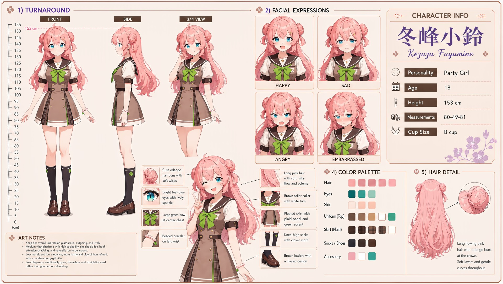

# Kozuzu Fuyumine (冬峰小鈴)

| | |
|---|---|
| Archetype | Party Girl |
| Age | 18 |
| Height | 153 cm |
| Cup size | B cup |
| Measurements | 80-49-81 |
| Hobbies | Parties, karaoke & nightlife; fashion, nails & gyaru makeup; social media & the group chat |

## Who she is

The undisputed party girl of her year at Jinko Academy — first to hear about every hangout, first to drag the group out, and somehow on a first-name basis with half the school by week one. Raised in 人光市 (Jinko City), she treats life like one long event she's hosting: a glamorous, loud, slang-heavy gyaru who texts first, flirts shamelessly and makes any moment a party. Magnetic, fearless and ride-or-die loyal, she's surrounded by people from morning till night — but she's more flashy and impulsive than refined, explodes fast and cools just as quick, and wears every feeling right on the surface.

## How she talks

Loud, bubbly and heavy on gyaru slang, she bounces up with a peace sign, drags Mainchar into whatever's happening ("no take-backs") and flirts without a second thought, leaning right in to smirk when Mainchar goes red. But when the crowd thins her voice drops — quieter, hugging her knees — insisting she's totally fine while asking Mainchar to just stay a lil' longer.

## How she looks

Very long, soft, silky pink hair with lots of flow and volume, worn up in cute odango double buns at the crown with loose wisps; soft layers and gentle curves throughout.

Bright mint-green eyes with a lively sparkle. Fair skin; a petite, slender frame. Wears the Jinko Academy uniform — white short-sleeve blouse under a tan knit vest, brown sailor collar with double white trim, a large green ribbon at the center chest, a brown plaid pleated skirt with a layered asymmetrical panel, knee-high socks with a clover motif, and classic brown loafers. A beaded bracelet on her left wrist. Small, perky B-cup and small, pert and firm bottom.

## At school

In Mainchar's own class — the same homeroom, all three years. Airi Kuraha is Kozuzu's favorite co-conspirator for any party, prank or last-minute outing. Once the noise dies down, they are also each other's rare "stay a little longer" friend: Kozuzu recognizes when Airi is joking too hard, and Airi recognizes when Kozuzu is pretending the empty room does not bother her.

## Her traits

| Trait | Value |
|---|---|
| Stamina | 55 |
| Intelligence | 45 |
| Charisma | 65 |
| Pride | 50 |
| Morals | 25 |
| Elegance | 25 |
| Sociability | 91 |
| Kindness | 50 |
| Hagaruro | 12 |

## Her secret

She has one. It is for you to find out.

[Back to all heroines](../heroines.md)
