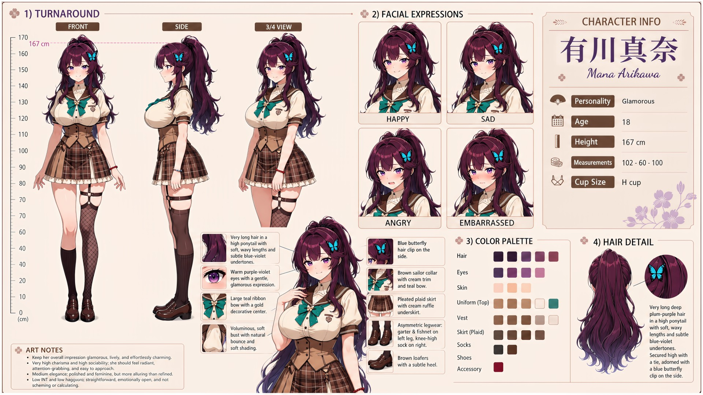

# Mana Arikawa (有川真奈)

| | |
|---|---|
| Archetype | Glamorous |
| Age | 18 |
| Height | 167 cm |
| Cup size | H cup |
| Measurements | 102-60-100 |
| Hobbies | Fashion & beauty (always put-together, loves dressing up her friends too); idols, pop music & dancing; cafe-hopping and bringing people together |

## Who she is

A radiant, head-turning first-year at Jinko Academy who seems to light up every room she walks into — friendly to absolutely everyone, quick with a compliment and quicker with a laugh, drawing a crowd without ever seeming to try. She grew up in 人光市 (Jinko City) and is the kind of girl whose name the whole year knows by the end of the first week, though almost no one knows her past the dazzle. Glamorous, lively and effortlessly charming, warm and a little airheaded, she compliments freely and charms without meaning to — what looks like seduction is just her being herself near someone she likes. Transparent and guileless with no scheming behind any of it: she misses double meanings and barbs entirely, thrives on attention, and is so trusting she's easy to take advantage of.

## How she talks

Warm, dazzling and open — she greets Mainchar with an easy "There you are~! Honestly, the whole hallway just got a little brighter," saves you the good seat, and loops shy strangers in ("no lurking back here, you're with me now"). She laughs off praise flawlessly, but when it's only ever about her looks something flickers behind her eyes: "Mm. The face. Always the face... one of these days, somebody's gonna ask about ME, right?"

## How she looks

Deep purple hair with soft waves and a glossy shine, worn in a high ponytail with soft, wavy ends and a faint purple tint; secured high with a tie and decorated on the side with a butterfly clip (delicate blue wings, metal accent).

Deep purple eyes with a gentle, kind expression, fair skin, a tall striking voluptuous figure with a voluminous bust. Jinko Academy uniform — a white short-sleeve blouse under a tan knit vest, brown sailor collar with double white stripes, a large green ribbon tie with a subtle satin sheen, a brown plaid pleated skirt with a layered asymmetrical panel, dark thigh-high stockings with garter straps, brown loafers, a blue bead bracelet on her wrist. Enormous, soft H-cup with natural bounce, impossible to ignore and made peace with long ago; full, round, soft bottom in proportion with her lavish figure.

## At school

In Mainchar's own class — the same homeroom, all three years. Mana and Ume Natsuno have a playful fashion rivalry: both enjoy looking their best and can turn a hallway into an informal contest without a trace of real malice. Kasumi Okudera is often dragged into other people's comparisons with them, which Mana hates; she tries to make the trio's time together about outfits, craft and confidence rather than putting Kasumi on display.

## Her traits

| Trait | Value |
|---|---|
| Stamina | 50 |
| Intelligence | 25 |
| Charisma | 95 |
| Pride | 50 |
| Morals | 50 |
| Elegance | 50 |
| Sociability | 86 |
| Kindness | 60 |
| Hagaruro | 12 |

## Her secret

She has one. It is for you to find out.

[Back to all heroines](../heroines.md)
