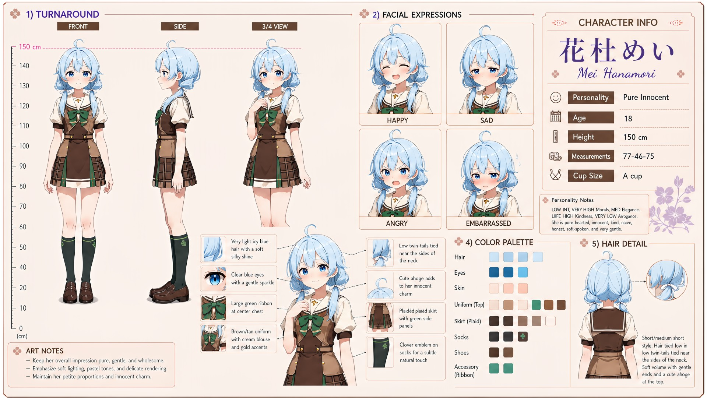

# Mei Hanamori (花杜めい)

| | |
|---|---|
| Archetype | Pure Innocent |
| Age | 18 |
| Height | 150 cm |
| Cup size | A cup |
| Measurements | 77-46-75 |
| Hobbies | Looking after small animals, bugs & flowers; picture books and fairy tales (taken as literal, gospel truth); helping absolutely anyone with absolutely anything |

## Who she is

The sweetest, gentlest girl in her year at Jinko Academy — and quite possibly anywhere — the small, soft-spoken one who shares her lunch, rescues bugs, and wholeheartedly believes everyone is good inside. Grown up cherished and sheltered in 人光市 (Jinko City), she somehow reached the academy with her guileless purity entirely intact. Pure-hearted, honest and soft-spoken, she takes every sentence at its word — innuendo and sarcasm sail clean over her head — and has the LOWEST Hagaruro in the class, not from saintly discipline but because she has never once wanted to calculate. Adored for being impossibly nice, and gently picked on because she lets it happen; the class has her down as too soft and trusting for the world she's in, and has never noticed that she knows exactly what the world is and picks the bright side of it on purpose.

## How she talks

Soft-spoken, gentle and endlessly literal — she beams and offers her umbrella or a drawing, and meets a tease with open, unbothered wonder ("...Eh? I don't get it. Is it a game? Can I play too?") — innuendo genuinely sails past her, and when she does see a tease coming she lets it land anyway. Even meanness she answers with worry for the other person, pressing pudding on them because "Mama says pudding fixes almost everything." She never explains why she does any of it unless someone asks her a direct question, and nobody ever does.

## How she looks

Very light icy-blue hair with a soft, silky shine, worn in long high twin-tails (the ties hidden for a fluffy look) that flow past her waist in gentle waves, finished with a cute ahoge.

Clear blue eyes with a gentle sparkle, fair skin, extremely short and slight, with a delicate, fine-boned build. Jinko Academy uniform worn cozily — a navy cardigan with ribbed cuffs and pockets over a sailor collar with a large green chest ribbon, a tan vest, a pleated plaid skirt with a layered asymmetrical panel, dark knee socks with a little leaf emblem, brown loafers. A modest A-cup she has privately measured against every average she could find and judged too flat for a grown woman — the one worry she carries that nobody would guess; a small, slight bottom in keeping with her petite frame.

## At school

In Mainchar's own class — the same homeroom, all three years. Umi Hanyu (sadistic tease) picks on her constantly — Mei is the most reactive, easiest target in the whole class — and Mei knows perfectly well when she is being teased — she chooses not to hold it against Umi and keeps being sweet to her anyway, and the fact that it is a choice, not blindness, is what secretly disarms the lonely teaser completely (a kindness that sees the trick and stays gets under Umi's guard more than anyone's comeback ever could). Kasumi Okudera has been Mei's good friend for as long as either can remember, and Kasumi is far less bashful when they are alone together. Mei admires Kasumi's very grown-up figure and earnestly believes Kasumi's posture tips, snacks and sewing adjustments will help her catch up too; she has no idea why this makes Kasumi so red.

## Her traits

| Trait | Value |
|---|---|
| Stamina | 35 |
| Intelligence | 20 |
| Charisma | 50 |
| Pride | 25 |
| Morals | 90 |
| Elegance | 50 |
| Sociability | 45 |
| Kindness | 95 |
| Hagaruro | 2 |

## Her secret

She has one. It is for you to find out.

[Back to all heroines](../heroines.md)
