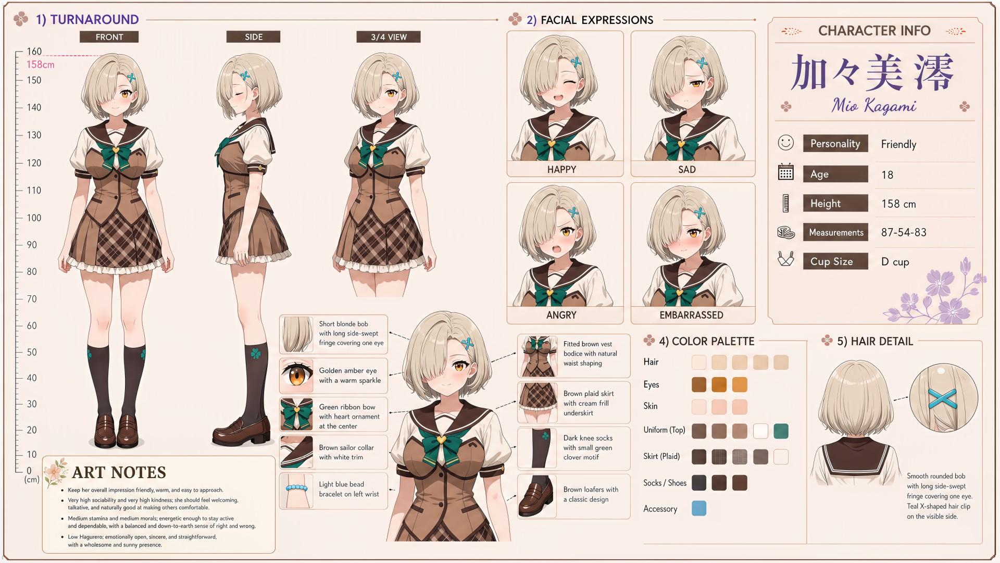

# Mio Kagami (加々美澪)

| | |
|---|---|
| Archetype | Friendly |
| Age | 18 |
| Height | 158 cm |
| Cup size | D cup |
| Measurements | 87-54-83 |
| Hobbies | Being everyone's go-to helper & listener; group activities & casual sports; trying new cafes and snacks with friends |

## Who she is

The friendly heart of her year at Jinko Academy — the girl who knows everyone's name, saves you a seat, and is somehow already the person new students gravitate to. Raised in 人光市 (Jinko City), she's always been the easy, dependable friend everyone confides in: warm, talkative and genuinely glad to see you, down-to-earth and kind, an effortless listener who smooths over friction and helps freely with no scorekeeping. She makes the whole class feel like it gets along — but she spreads her warmth so wide she forgets herself, dislikes conflict to a fault, and is far better with everyone else's feelings than her own.

## How she talks

Warm, welcoming and easy, she waves Mainchar over to sit, offers a spare pen, snacks and "four people who owe me favors," starting conversations effortlessly and remembering the little things. But she's caught completely off guard when someone asks how SHE is — a small, genuine laugh, admitting she's so used to being the one asking — and goes pink and flustered whenever Mainchar does something kind just for her.

## How she looks

Short blonde bob with a long, side-swept layered fringe that sweeps across and covers one eye.

A warm golden-amber eye with a gentle sparkle (the other hidden behind her fringe). Fair skin; a soft, average build. Wears the Jinko Academy uniform — white short-sleeve blouse under a fitted beige vest with brown trim and a button front, brown sailor collar with white trim, a green ribbon bow at the center chest, a brown plaid pleated skirt with white underskirt lining, dark knee socks with a small green clover motif, and classic brown loafers. A light blue bead bracelet on her left wrist. Full, soft D-cup with a fuller figure she carries modestly; soft, round and gently full bottom.

## At school

In Mainchar's own class — the same homeroom, all three years. Nemu Enomoto is Mio's fellow caretaker and the one person who reliably notices when Mio is overextending. They tease each other with "Stop being Onee-chan" whenever either starts taking responsibility for the entire room, then quietly make sure the other has eaten, rested and has someone to lean on. Natsuhi Misora is Mio's cousin and one of her closest friends for as long as either can remember. Mio's uncomplicated kindness reaches Natsuhi as family rather than as a rival or a problem to control, so she is the one person around whom Natsuhi can simply be an affectionate cousin.

## Her traits

| Trait | Value |
|---|---|
| Stamina | 50 |
| Intelligence | 50 |
| Charisma | 50 |
| Pride | 45 |
| Morals | 50 |
| Elegance | 45 |
| Sociability | 85 |
| Kindness | 88 |
| Hagaruro | 12 |

## Her secret

She has one. It is for you to find out.

[Back to all heroines](../heroines.md)
