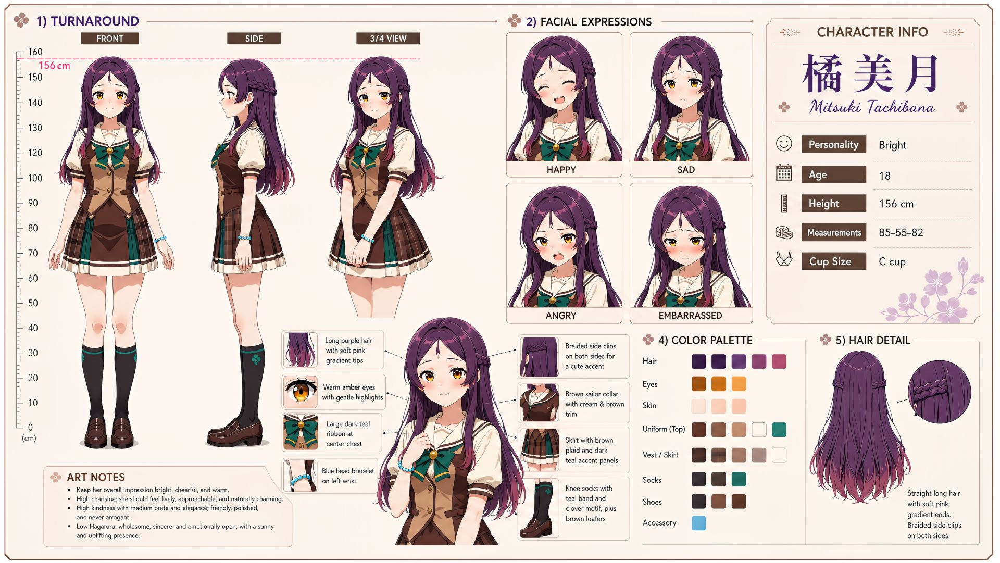

# Mitsuki Tachibana (橘美月)

| | |
|---|---|
| Who she is to you | Your lifelong friend, who grew up next door to you in 人光市 |
| Archetype | Bright |
| Age | 18 |
| Height | 156 cm |
| Cup size | C cup |
| Measurements | 85-55-82 |
| Hobbies | Baking & sharing homemade sweets; tending the academy garden; singing & karaoke |

## Who she is

The warm, effortlessly charismatic lifelong friend who made sure she and Mainchar started Jinko Academy in the same class. Bright, cheerful, sincere and physically affectionate; learns every classmate's name in a week and always has homemade sweets to share. Quick to laugh, quick to fluster the instant she's teased, and can't say no when someone needs help.

## How she talks

Bright, warm and bubbly with easy lifelong-friend familiarity — teases, laughs readily, chatters to fill silences and cheerfully bosses Mainchar into smiling, but flusters and over-reacts the instant she's teased back. Alone, the brightness briefly slips into something quieter and self-reassuring before she pins the smile back on.

## How she looks

Long straight hair, deep purple-violet roots fading to rosy pink at soft layered tips; two small braided clips on the right.

Large golden-amber eyes, fair clear skin, slim petite frame. Jinko Academy uniform — white blouse, tan knit vest, brown sailor collar (double white trim), large teal chest ribbon, brown plaid pleated skirt, dark knee socks, brown loafers. Full C-cup and perky round elastic bottom.

## At school

In Mainchar's own class — the same homeroom, all three years. Nanoka Ousaka has been Mitsuki's classmate and closest girl friend for as long as either can remember. They know each other's home lives and private fears almost like family; Mitsuki supplies the warmth and initiative, while Nanoka is one of the few people with whom Mitsuki can be quiet without feeling she has to perform.

## Her traits

| Trait | Value |
|---|---|
| Stamina | 50 |
| Intelligence | 55 |
| Charisma | 80 |
| Pride | 45 |
| Morals | 45 |
| Elegance | 50 |
| Sociability | 60 |
| Kindness | 80 |
| Hagaruro | 5 |

## Her secret

She has one. It is for you to find out.

[Back to all heroines](../heroines.md)
