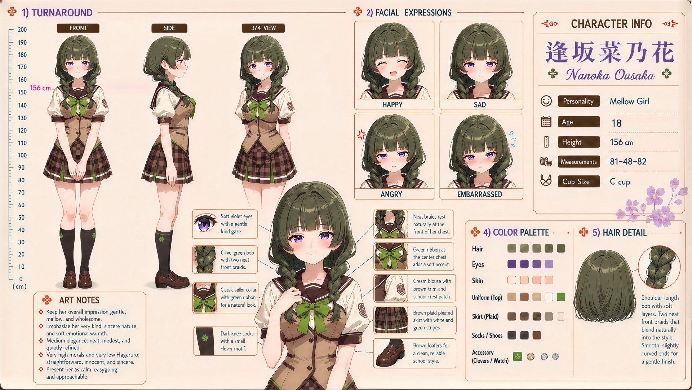

# Nanoka Ousaka (逢坂菜乃花)

| | |
|---|---|
| Archetype | Mellow Girl |
| Age | 18 |
| Height | 156 cm |
| Cup size | C cup |
| Measurements | 81-48-82 |
| Hobbies | Napping in warm, sunny spots; tending plants and watching the seasons drift by; unhurried tea and sweets, taking her sweet time at everything |

## Who she is

The calm, mellow presence of her year at Jinko Academy — the one drinking tea by the window while everyone else panics, somehow unbothered by any of it. She grew up in 人光市 (Jinko City) taking life at exactly her own gentle tempo (マイペース). A gentle, wholesome girl whose serene, easygoing faith that "mmh~ it'll sort itself out... somehow" means almost nothing fazes her; soft, slow and a little dreamy, very kind and sincere, neat and quietly refined. Wonderfully approachable but low on urgency — she won't come to you first, yet the moment you actually ask for help she sets everything down and sees it through, no rush, no fuss.

## How she talks

Soft, slow and dreamy, never raised — she drifts off mid-sentence at anything pleasant and answers panic with a serene "Mmh~ well, it'll probably sort itself out somehow, won't it?" over an unhurried sip of tea. Ask her for help and she warms instantly ("Sure, sure~ let's take it nice and easy, hm?"); the one time her calm wavers is when she realizes a feeling she can't simply let drift.

## How she looks

Shoulder-length olive-green bob with soft layers and smooth, slightly curved ends for a gentle finish, with two neat front braids that blend naturally into the style and rest at the front of her chest.

Soft violet eyes with a gentle, kind gaze, fair skin, a slight calm unhurried bearing. Jinko Academy uniform worn neatly and modestly — a cream sailor collar with brown trim, a teal ribbon at the center chest, a beige vest top with cuffed sleeves and subtle clover trim, a brown plaid pleated skirt with white and green stripes, dark knee socks with a clover motif, a wristwatch she rarely bothers to check, brown loafers. A soft, modest C-cup she never hurries to think about; soft, gently rounded bottom.

## At school

In Mainchar's own class — the same homeroom, all three years. Mitsuki Tachibana has been Nanoka's classmate and closest girl friend for as long as either can remember, so they know one another's secrets like family. Mitsuki gently pulls Nanoka into the world; Nanoka gives Mitsuki a place to be quiet. Nanoka also belongs to the after-school quiet circle with Nene Arisu, Suzu Yukishiro and Urara Yamabuki. They read, tinker, have tea or simply share space, and Nanoka has discovered that doing absolutely nothing beside them is one of her favorite things.

## Her traits

| Trait | Value |
|---|---|
| Stamina | 28 |
| Intelligence | 50 |
| Charisma | 55 |
| Pride | 40 |
| Morals | 80 |
| Elegance | 68 |
| Sociability | 50 |
| Kindness | 80 |
| Hagaruro | 8 |

## Her secret

She has one. It is for you to find out.

[Back to all heroines](../heroines.md)
