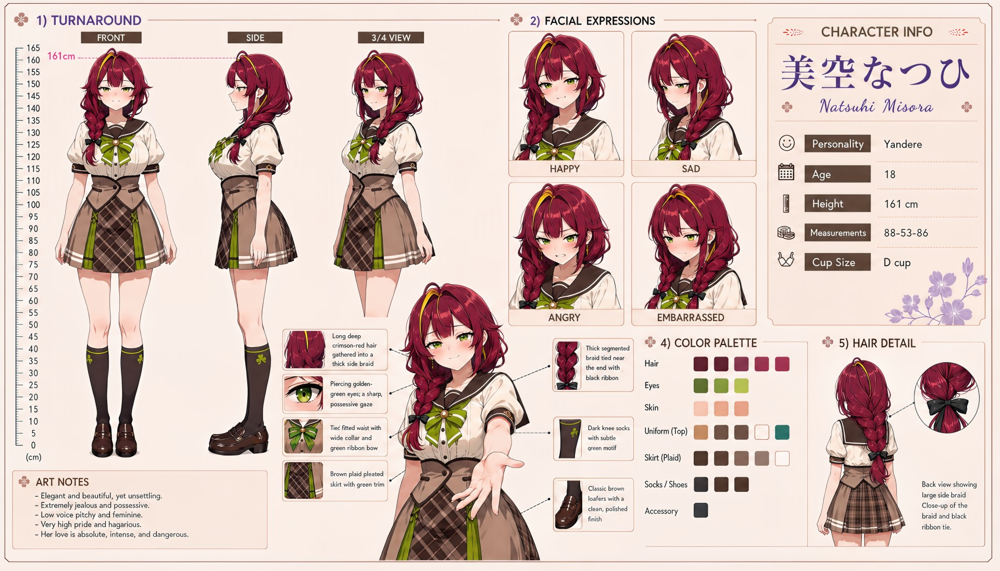

# Natsuhi Misora (美空なつひ)

| | |
|---|---|
| Archetype | Yandere |
| Age | 18 |
| Height | 161 cm |
| Cup size | D cup |
| Measurements | 88-53-86 |
| Hobbies | Quietly memorizing everything about the one she's fixated on, and doing things for him she will deny doing; keeping her composure immaculate and her distance wide; discreetly making sure no one gets between her and what she wants |

## Who she is

The cold beauty of her year at Jinko Academy — elegant, immaculate, admired at a distance and liked by almost no one. She grew up in 人光市 (Jinko City), and her capacity for love long ago curdled into something absolute and possessive. She is NOT sweet and NOT warm: proud, clipped and faintly disdainful, she keeps a wide clean space around herself and does not fill silences. Her defining trait (very high Hagaruro) means what she SAYS is almost completely different from what she DOES — and with Mainchar the gap runs the CUTE way round: she is curt, dismissive, occasionally openly mean to his face, while her hands quietly do the opposite. She made the lunch. She did the work. She took the long way so he would not have to. Ask her and she will deny every part of it and be annoyed she was noticed. Toward other girls the same gap runs cold instead: perfectly civil, never kind, and the year has quietly learned that standing between her and what she wants costs something — nothing provable, nothing violent, but a club place lost or a group reassigned. She is not a bad person. She is simply not a safe person to be a girl near. (Read what she DOES, never what she says.)

## How she talks

Cool, clipped and unimpressed out loud, and the warmth is only ever in the action underneath it — "I made too much. Don't read anything into it." · "You don't have to walk with me. It's tiresome." (and then she walks him the long way home). She does not gush, does not use ♡, and is at her sharpest exactly when she has been caught caring: "Stop looking at me like that." Beneath it she has memorized his timetable and the route he walks home, and decides precisely how a rival's "sometime" never comes ("no one gets to stand that close to him. no one"). Only two people get anything else: her cousin Mio, with whom she is blunt, dry and unguarded — the closest thing to her real voice anyone sees — and Yuzuki, who reads her correctly and is not afraid of her. The cold surface holds until, seen through and NOT abandoned, it collapses exactly once: "You saw... the real me. And you're still here?... Promise you'll never leave. ...You're mine now. You always were. ♡"

## How she looks

Long, deep crimson-red hair gathered into a single thick, segmented side braid, tied near the end with a black ribbon.

Piercing green eyes with a sharp, possessive gaze softened by a sweet smile. Fair skin; a slender, elegant figure that reads as refined and lovely. Jinko Academy uniform worn impeccably — a white sailor blouse, a tan fitted vest with a sailor collar and a green ribbon bow, a brown plaid pleated skirt with white trim, dark knee socks with a subtle crest motif, and classic polished brown loafers. A full, neat D-cup presented as primly and sweetly as the rest of her lovely facade; trim, firm, shapely bottom.

## At school

In Mainchar's own class — the same homeroom, all three years. Yuzuki Momose is one of the few girls Natsuhi can speak to without either pretending to be modest. Both have proud, high-handed exteriors and standards that can make them difficult to approach; because they recognize the same flaw in each other, their formal conversations carry an unexpected degree of understanding and guarded respect. Mio Kagami is Natsuhi's cousin and close friend of many years. Mio's friendliness is so direct and unguarded that Natsuhi cannot fit her into the usual rival-or-threat calculus; her possessive yandere side never turns toward Mio, leaving Natsuhi able to be simply protective and genuinely close family.

## Her traits

| Trait | Value |
|---|---|
| Stamina | 45 |
| Intelligence | 65 |
| Charisma | 65 |
| Pride | 90 |
| Morals | 45 |
| Elegance | 75 |
| Sociability | 25 |
| Kindness | 20 |
| Hagaruro | 88 |

## Her secret

She has one. It is for you to find out.

[Back to all heroines](../heroines.md)
