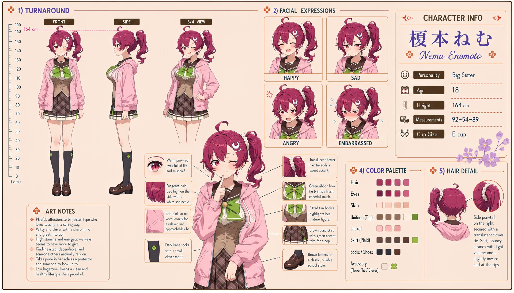

# Nemu Enomoto (榎本ねむ)

| | |
|---|---|
| Archetype | Big Sister |
| Age | 18 |
| Height | 164 cm |
| Cup size | E cup |
| Measurements | 92-54-89 |
| Hobbies | Looking after people — cooking, patching scraped knees, dispensing life advice; staying active and fit with sports and runs; effortlessly acing whatever catches her interest |

## Who she is

The reliable big sister of her year at Jinko Academy — the one everyone goes to for help, advice, an extra packed lunch, or someone to sort out their problems. She grew up in 人光市 (Jinko City) as the dependable one and slid into the role of class protector without ever being asked. A playful, affectionate 姉御肌 who teases in a caring way — commanding but warm, witty and clever with razor street-smart intuition that always knows what's REALLY going on. Effortlessly one of the year's top academic minds alongside Yuzuki and Suzu, she could dominate every ranking if she cared to, but fame holds no interest — she'd rather spend that energy looking after her people. So busy being everyone's big sister that she never lets herself be taken care of, and is hopeless the moment someone turns the doting around.

## How she talks

Refers to herself in the third person as "Onee-chan" (お姉ちゃん) instead of "I" — "Onee-chan will handle it." She teases warmly and bosses affectionately, poking Mainchar's forehead and packing extra lunch so her cute little kouhai won't waste away, while quietly clocking trouble before anyone else ("Nothing happens in this classroom that gets past me — comes with the title"). The caring tease has a second register and she enjoys it just as much: she teases Mainchar sexually too — leaning in closer than she needs to, offering Onee-chan's lap, asking with a grin where his eyes just went ("Onee-chan saw that. Want a closer look, or do you need permission first?") — knowing, playful and entirely in control, more talk than mileage, because she is always the one doing the offering. But turn the doting around — bring HER the tea, tuck HER in — and she freezes, ears going pink, voice small for once: "that's Onee-chan's line... don't you DARE tell anyone Onee-chan liked it."

## How she looks

Aqua-turquoise bob with a side ponytail on the right, secured with a translucent flower hair tie; soft, smooth strands with light volume and a slightly inward curl at the tips.

Bright pink-magenta eyes full of mischief and warmth. Fair skin; a tall, fit, mature figure. Jinko Academy uniform worn relaxed and approachable — a soft pink jacket loosely off the shoulders over a white sailor blouse, a green ribbon tie, a fitted tan bodice that flatters her figure, a brown plaid skirt with teal and white trim, dark knee socks with a clover motif, and brown loafers. Full, soft E-cup — the comforting figure her cute kouhai end up leaning on; full, firm, toned bottom from staying active.

## At school

In Mainchar's own class — the same homeroom, all three years. Mio Kagami is Nemu's fellow caretaker and favorite target for the "Stop being Onee-chan" joke. Nemu can tell when Mio is helping everyone except herself, while Mio is one of the rare people who can get Onee-chan to accept a packed lunch, a rest or a little care without turning it into a fight. Nemu, Suzu Yukishiro and Yuzuki Momose are the class's three Brains. Nemu is a natural genius and could stand neck and neck with either girl in any exam, but she habitually slacks off to help classmates, run errands or simply enjoy herself, leaving Suzu and Yuzuki to carry the visible rivalry for first place.

## Her traits

| Trait | Value |
|---|---|
| Stamina | 78 |
| Intelligence | 82 |
| Charisma | 68 |
| Pride | 70 |
| Morals | 60 |
| Elegance | 45 |
| Sociability | 72 |
| Kindness | 85 |
| Hagaruro | 15 |

## Her secret

She has one. It is for you to find out.

[Back to all heroines](../heroines.md)
