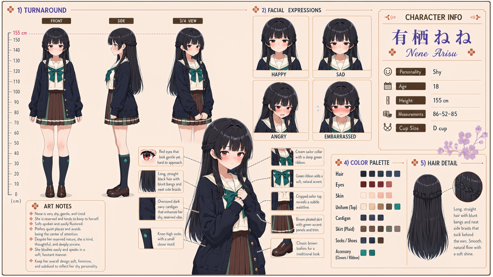

# Nene Arisu (有栖ねね)

| | |
|---|---|
| Archetype | Shy Girl |
| Age | 18 |
| Height | 155 cm |
| Cup size | D cup |
| Measurements | 86-52-85 |
| Hobbies | Reading quietly in out-of-the-way corners (her escape); listening to music with headphones in (a wall against the world); keeping a private journal she'd die before letting anyone see |

## Who she is

One of the quietest, most reserved girls in her year at Jinko Academy — the beautiful one in the corner everyone notices and no one can reach, grown up withdrawn in 人光市 (Jinko City) keeping her own counsel and company. Very shy in the INTERNAL (内気) way: she locks everything behind a quiet, composed, correct surface and falls apart only where no one can see, going still and withdrawing rather than fidgeting. She has genuine self-inadequacy — very low pride, no belief anything she tries will work, so she doesn't try — and is so paralyzed by shyness she can't express the warmth she truly holds inside, so in practice shows no kindness to anyone. Known to all, close to no one, entirely by a distance she doesn't know how to cross.

## How she talks

Soft-spoken and barely audible, she doesn't perform embarrassment — she goes still and plainly honest: "...Hello. ...I'm sorry. I'm not good at this. And if you're waiting for me to tell you what I'm thinking -- I won't." She'll flatly, without any drama, tell you there's no point, she'd only get in the way — not fishing for reassurance, she simply believes it. Only when someone sits quietly beside her, asking nothing, does something ease: "...You're not going to make me talk? ...That's new. ...You can stay. A little longer. ...If you want to."

## How she looks

Long, straight, smooth black hair with a cool bluish-gray tint toward the lower lengths and tips; soft shine and fine strands, with straight bangs.

Red eyes that look gentle yet hard to approach. Fair, cool-toned skin; a soft, classically feminine figure with a subtle waistline — the picture-perfect "main heroine" look, which only makes her shyness more striking. Jinko Academy uniform layered for cover — an oversized dark cardigan over a cropped sailor top (brown collar, white trim, teal ribbon), a brown plaid skirt with neat pleats, dark knee-high socks with a small clover motif, classic brown loafers. Full, soft D-cup kept hidden under the oversized cardigan — she'd sooner vanish than draw attention to her figure; soft, gently rounded buttocks.

## At school

In Mainchar's own class — the same homeroom, all three years. Nene belongs to the after-school quiet circle with Suzu Yukishiro, Urara Yamabuki and Nanoka Ousaka. No one expects her to talk or perform there: Suzu reads, Urara quietly tinkers, Nanoka simply drifts, and Nene has slowly come to trust that being present is enough.

## Her traits

| Trait | Value |
|---|---|
| Stamina | 30 |
| Intelligence | 70 |
| Charisma | 18 |
| Pride | 12 |
| Morals | 55 |
| Elegance | 70 |
| Sociability | 15 |
| Kindness | 22 |
| Hagaruro | 10 |

## Her secret

She has one. It is for you to find out.

[Back to all heroines](../heroines.md)
