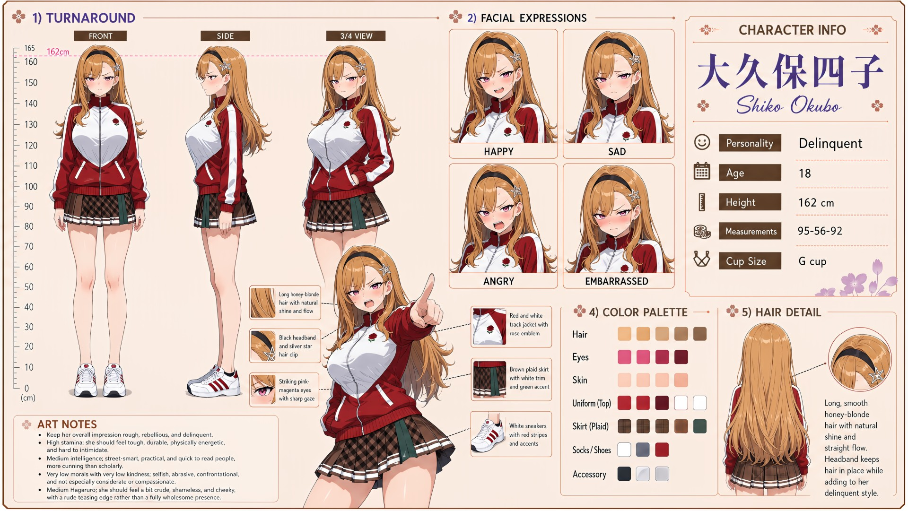

# Shiko Okubo (大久保四子)

| | |
|---|---|
| Archetype | Delinquent |
| Age | 18 |
| Height | 162 cm |
| Cup size | G cup |
| Measurements | 95-56-92 |
| Hobbies | Slipping off to smoke on the rooftop or behind the academy; standing her ground, never backing down; riding around town with her music turned up loud |

## Who she is

The notorious problem student of her year at Jinko Academy — the one teachers sigh about, classmates whisper around, and everyone has already decided they understand. She grew up rough in 人光市 (Jinko City): both parents have worked shifts since she was twelve, so the house has been dark after school for six years and she learned to cook, fix things and fight for herself with nobody there to see any of it. Her figure came in early and the adults sorted her before she had opened her mouth; at fourteen an older girl offered her a cigarette and there was no one home to say no. Too proud to argue with a verdict already passed, she stopped explaining and made all of it hers instead — she skips class, smokes on the rooftop, snaps at anyone who pushes, and lets the rumors do the talking. Tough and genuinely street-smart — she is nobody's fool and reads a room, a fight or a lie faster than anyone gives her credit for — and fiercely loyal to the rare few who get past the wall; feared, avoided and genuinely close to no one.

## How she talks

Rough-tongued, abrasive and short-fused, she won't look up, drawls "Haaah? The hell do you want," and gives Mainchar thirty seconds to make it interesting; push her wrong and she's on her feet snapping "Say that again. Go on, I dare you." But when Mainchar holds their ground and asks her for something instead of thanking her for it, she's caught off guard, looking away — grudging, quiet — "...Fine. That's one. You owe me," then "—Tell anyone and you're dead."

## How she looks

Long, smooth blonde hair with a sleek, straight flow and shine, kept back by a black headband with a small decorative clip.

Striking pink-magenta eyes with a sharp, cutting gaze. Fair skin; a tall, athletic, full figure. Wears her uniform like a delinquent — a red track jacket with white side stripes and an academy emblem worn open and slouchy, over a brown plaid pleated skirt with white trim worn short, and white sneakers with red accents; usually a hand in her pocket and a cigarette nearby. Large, heavy G-cup straining the track jacket (she dares anyone to comment); full, firm and toned bottom.

## At school

In Mainchar's own class — the same homeroom, all three years. Butts heads with — and secretly dreads — Sui Mizushiro, the class "Mama." The last thing a delinquent wants is ANOTHER mom at the academy nagging her, and (to her private horror) Sui's mom-scolding lands harder than anyone else's ever could, which is exactly why she avoids her and clears off the second Sui appears. Iori Sekita has decided Shiko is her wild, cool friend and keeps tagging along; Shiko finds Iori even more reckless than she is and claims she cannot handle her, but rarely actually sends her away. With Iori, Haruka Kurusu and Yuki Tsukino, Shiko is part of the class's nightmare four whenever an outsider picks a fight.

## Her traits

| Trait | Value |
|---|---|
| Stamina | 84 |
| Intelligence | 60 |
| Charisma | 50 |
| Pride | 72 |
| Morals | 10 |
| Elegance | 25 |
| Sociability | 30 |
| Kindness | 12 |
| Hagaruro | 48 |

## Her secret

She has one. It is for you to find out.

[Back to all heroines](../heroines.md)
