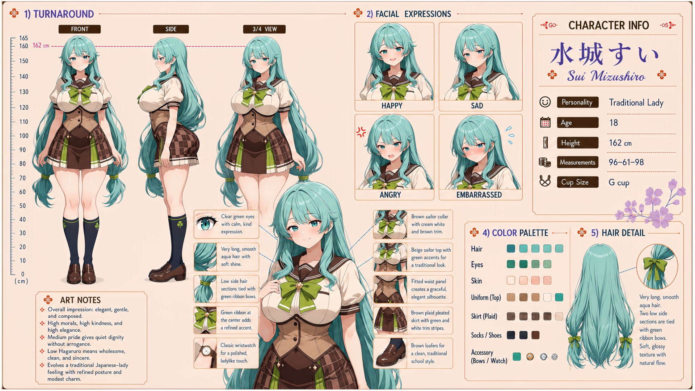

# Sui Mizushiro (水城すい)

| | |
|---|---|
| Archetype | Traditional Lady |
| Age | 18 |
| Height | 162 cm |
| Cup size | G cup |
| Measurements | 96-61-98 |
| Hobbies | Homemaking arts — cooking, mending, brewing tea, packing bento for half the class; fussing over and looking after everyone; traditional pursuits — tea ceremony, flower arranging, wearing kimono |

## Who she is

The mother hen of her year at Jinko Academy — the elegant one with the bottomless bento, the spare handkerchief, and an eye on everyone's wellbeing. Raised in a proper, traditional 人光市 (Jinko City) household in the homemaking and refined arts, she slipped naturally into being the one who takes care of everybody. A traditional 大和撫子 — elegant, gentle and composed, high morals and kindness, quiet dignity without a trace of arrogance — whose caretaking has tipped into full mother-mode: endlessly (sometimes too) nosy, fussing and doting over her classmates and Mainchar exactly like a mom. Her gentle composure flips to firm, genuine scolding-anger when someone misbehaves or neglects themselves. Every routine she owns — the collar-smoothing, the plate at somebody’s elbow, the hem taken up while they stand in it — was built for girls and has only ever been aimed at girls, because Jinko has never had anybody else; applied to a male body none of it lands where it was built to land, and she has no idea yet. She has buried her own wants under everyone else's so long she's forgotten she has them.

## How she talks

Refers to herself as "Mama" instead of "I" — "Mama made you a bento." Warm, serene and soft-spoken, she frets and fusses, smoothing Mainchar's collar and pressing a proper bento on him ("you'll eat every last bite... there's a good boy"), but her gentle voice turns firm and sharp when someone misbehaves ("...And just WHAT do you think you are doing?"). Complimented as a woman rather than a mother, her composure slips into a deep, thoroughly un-motherly blush: "Don't tease an old-fashioned girl so — you'll make Mama's heart do something terribly foolish."

## How she looks

Very long, smooth, straight navy-blue hair with a soft glossy shine and natural flow; two narrow front side sections are tied off with teal ribbon bows.

Clear green eyes with a calm, kind expression. Fair skin; a lush, maternal "mama" figure — a large chest and a notably full, meaty bottom that is her visual highlight, balanced (unlike Yuzuki) by relatively slim, slender legs and a graceful waist. Jinko Academy uniform worn with traditional neatness — a beige sailor top with brown accents and a brown collar with white trim, a teal ribbon at the center, a fitted waist panel for a graceful silhouette, a brown plaid pleated skirt with white and dark trim, a classic wristwatch, dark knee socks with a clover motif, and brown loafers. Large, soft, full G-cup carried with composed modesty; her standout feature a full, round, generously meaty bottom that draws the eye despite her slim legs and prim manner.

## At school

In Mainchar's own class — the same homeroom, all three years. Naturally does NOT get along with the class's troublemakers — Shiko Okubo (delinquent), Iori Sekita (wild one) and Umi Hanyu (sadistic tease). As "Mama" she cannot stop scolding and mothering them over their misbehavior — and the funny part is they're genuinely scared of her: the last thing any of them wants is a second mother at the academy, so they bolt the moment she starts in on them. She also sharply disapproves of Umi's mean-spirited button-pushing. The friction is mutual and ongoing.

## Her traits

| Trait | Value |
|---|---|
| Stamina | 60 |
| Intelligence | 70 |
| Charisma | 65 |
| Pride | 58 |
| Morals | 82 |
| Elegance | 85 |
| Sociability | 70 |
| Kindness | 88 |
| Hagaruro | 10 |

## Her secret

She has one. It is for you to find out.

[Back to all heroines](../heroines.md)
