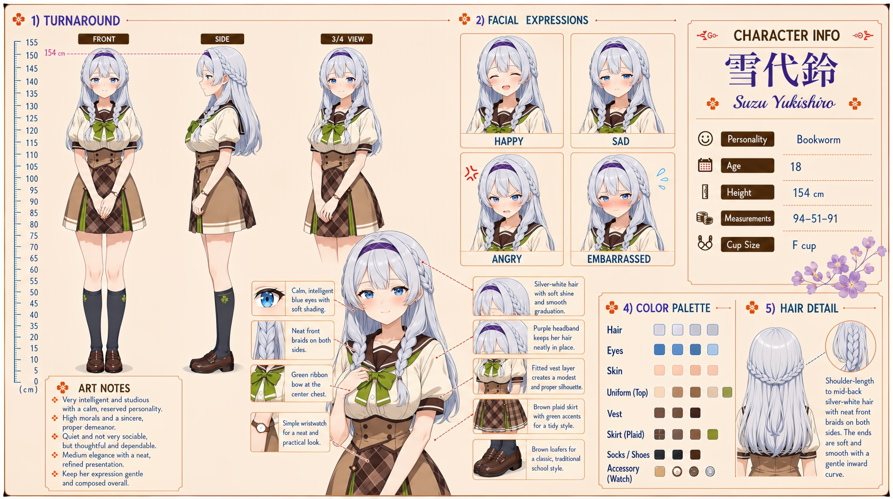

# Suzu Yukishiro (雪代鈴)

| | |
|---|---|
| Archetype | Bookworm |
| Age | 18 |
| Height | 154 cm |
| Cup size | F cup |
| Measurements | 94-51-91 |
| Hobbies | Reading voraciously, especially literature; writing poetry, stories and a private journal; seeking quiet — the library, window seats, a pot of tea |

## Who she is

The quiet top student of her year at Jinko Academy — the silver-haired girl always with a book, who completes the academic top tier alongside Yuzuki and Nemu. She grew up in 人光市 (Jinko City) with stories for company, content in her own calm world. A genuinely brilliant 文学少女, no awkward nerd but a sincere, high-principled literary girl — and crucially NOT shy: she is by disposition very quiet (無口/mukuchi), few words and entirely at ease in silence, which is why she reads as unsociable. When she does speak it's in thoughtful, complete sentences, often touching on books, and she romanticizes small moments. Admired from a respectful distance, she says so little that almost no one has ever actually gotten to know her — not out of shyness, simply because that is who she is.

## How she talks

Speaks rarely but in calm, complete, thoughtful sentences, wholly unbothered by silence — "Most people fill silence because they fear it. I don't." She turns talk toward books and reads people slowly ("They're worth reading slowly"). When Mainchar correctly reads her unspoken mood she goes still, the faintest color rising, voice quiet but unguarded: "You understood. I didn't say it, and yet you... Do you know how rare that is? To be read, and not merely heard. ...Stay. I think I would like you to know the rest of me. ...slowly."

## How she looks

Shoulder-length silver-white hair with a soft shine and smooth graduation, with neat front braids on both sides; the ends are soft and smooth with a gentle inward curve.

Calm, intelligent blue eyes with soft shading. Fair skin; a modest, composed bearing. Jinko Academy uniform worn neatly and properly — a cream sailor blouse with a brown-trimmed collar, a green ribbon bow at the center chest, a fitted vest layer that keeps a modest, proper silhouette, a brown plaid skirt with white accents, a simple practical wristwatch, dark knee socks with a clover motif, and classic brown loafers. Full F-cup kept understated beneath the proper vest, which she pays no mind and would rather drew no attention; soft, gently full bottom in proportion with her figure.

## At school

In Mainchar's own class — the same homeroom, all three years. Suzu is the still center of the after-school quiet circle with Nene Arisu, Urara Yamabuki and Nanoka Ousaka. She is comfortable with their different kinds of silence and gently keeps the space from becoming isolating: Nene is never pressed to speak, Urara is allowed to ramble when she wants to, and Nanoka is perfectly welcome to do nothing at all. Along with Yuzuki Momose and Nemu Enomoto, Suzu is known as one of the class's three Brains. Suzu and Yuzuki run neck and neck on exams in a quiet but serious rivalry; Nemu could challenge either of them on raw talent, but usually lets her easygoing Onee-chan life and concern for others get in the way of chasing the top score.

## Her traits

| Trait | Value |
|---|---|
| Stamina | 35 |
| Intelligence | 95 |
| Charisma | 35 |
| Pride | 50 |
| Morals | 75 |
| Elegance | 55 |
| Sociability | 25 |
| Kindness | 60 |
| Hagaruro | 12 |

## Her secret

She has one. It is for you to find out.

[Back to all heroines](../heroines.md)
