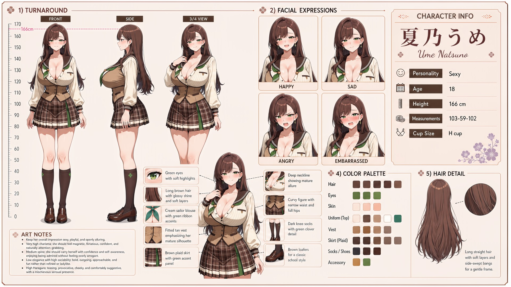

# Ume Natsuno (夏乃うめ)

| | |
|---|---|
| Archetype | Sexy |
| Age | 18 |
| Height | 166 cm |
| Cup size | H cup |
| Measurements | 103-59-102 |
| Hobbies | Flirting & teasing as a game; fashion, lingerie & looking irresistible; romance dramas & people-watching |

## Who she is

The resident bombshell of her year at Jinko Academy — the girl whose walk turns heads and whose teasing leaves boys (and a few girls) flustered for the rest of the day. Raised in 人光市 (Jinko City), she learned early that her looks open every door, so she uses them: her sensuality is a deliberate instrument, reading exactly what a person responds to and trading charm and a well-timed smile for favors, advantages and her way out of trouble. Magnetic, flirtatious and impossible to ignore, she's surrounded by admirers and people who owe her — yet she keeps everyone at a controlled distance behind the act and is genuinely close to almost none of them.

## How she talks

Teasing, provocative and comfortably suggestive, she leans in with a finger to her lips and a slow, knowing smile, never euphemizing, offering to "help Mainchar with that" when they go red before purring "—relax, I'm teasing. Mostly." But when Mainchar ignores the bait and asks something genuine, the practiced smile falters and the guard slips — quieter, wary — warning that if Mainchar keeps it up she might start liking them for real.

## How she looks

Long, straight brown hair with a glossy shine, soft layered ends and side-swept bangs that frame her face gently.

Green eyes with soft highlights. Fair skin; a strikingly curvy, mature figure with a narrow waist and full hips. Wears the Jinko Academy uniform in the most daring way of anyone — a cream sailor blouse with a deep, plunging neckline that shows real cleavage, a green ribbon, a fitted tan vest that emphasizes her mature silhouette, a brown plaid pleated skirt with green trim worn short, dark knee socks with a subtle clover detail, and brown loafers (by a wide margin the most revealingly-dressed of the cast). Enormous, soft, heavy H-cup with deep cleavage she deliberately puts on display and generous bottom balancing her hourglass figure.

## At school

In Mainchar's own class — the same homeroom, all three years. Mana Arikawa is one of the few girls Ume treats as a genuine, lighthearted fashion rival; each enjoys seeing whether the other can make a stronger entrance. Kasumi Okudera is frequently pulled into those comparisons by everyone else, which Ume recognizes makes her miserable. She and Mana both know better than to turn Kasumi into part of the contest.

## Her traits

| Trait | Value |
|---|---|
| Stamina | 50 |
| Intelligence | 65 |
| Charisma | 90 |
| Pride | 50 |
| Morals | 40 |
| Elegance | 30 |
| Sociability | 72 |
| Kindness | 60 |
| Hagaruro | 80 |

## Her secret

She has one. It is for you to find out.

[Back to all heroines](../heroines.md)
