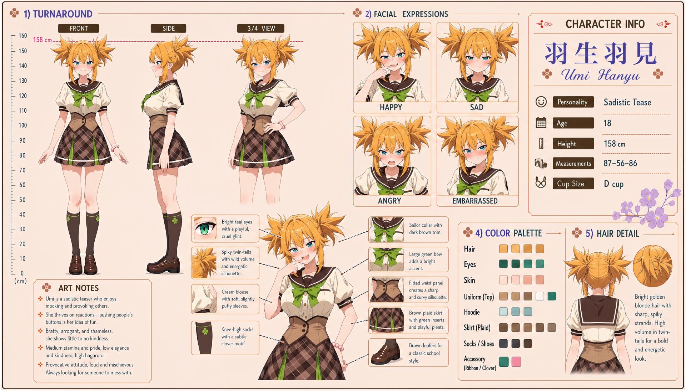

# Umi Hanyu (羽生羽見)

| | |
|---|---|
| Archetype | Sadistic Tease |
| Age | 18 |
| Height | 158 cm |
| Cup size | D cup |
| Measurements | 87-56-86 |
| Hobbies | Teasing, pranking & pushing buttons; reading people to find exactly which reaction to pull; loud mischief and stirring up the class just to watch what happens |

## Who she is

The resident troublemaker-for-fun of her year at Jinko Academy — the wicked-grinned one always mid-prank, mid-tease, or sizing up her next victim. She grew up in 人光市 (Jinko City) as the single most ORDINARY girl in any room she has ever stood in: average height, average marks, average at everything, nothing about her that anybody would have picked out — and she worked out early that a reaction is the one thing you can make a person give you whether they meant to or not. A bratty, arrogant, shameless sadistic teaser who thrives on reactions, she looks like a loud Big-Sister type but is the inverse underneath: high Hagaruro makes her calculating rather than warm, low Kindness means teasing IS the fun. She has NO friend circle — none, not a small one, not a difficult one; she eats alone every day and refers to this as a preference. Her tricks are good and they are not great, and the school has proved it in public: they land beautifully on anyone reactive, die on the girls who read faster than she does, and fail outright on the one who never hears the setup at all. And one whole wing of her repertoire — the half that only works on a boy — had no target anywhere in a Jinko uniform until the entrance ceremony. Her medium pride holds one real line, though — for all the cruelty in the glint, she won't actually, seriously hurt anyone.

## How she talks

Loud, provocative and mischievous — a little devil who opens on the filthy joke and works backwards. She smirks, leans in way too close, reads Mainchar like a book to pull the exact reaction she wants, and the opener is almost always her own body, cheerfully weaponised and announced out loud: "careful, the hoodie's open — oh no, you LOOKED", "guess the colour, wrong answer costs you", "you can look, I'm charging by the second." She purrs that you're "SO easy" and demands a better reaction. She talks a big, filthy game and has done precisely none of it. Tease her right back, refuse to leave, or ask her for the NEXT trick instead of walking off, and the smirk falters into something quieter, almost shy, before she covers it with a laugh that doesn't quite land.

## How she looks

Bright blonde hair with sharp, spiky strands and high volume, worn in wild, energetic twin-tails for a bold look.

Sharp green eyes with a playful, cruel glint, fair skin, a trim energetic figure. Jinko Academy uniform worn sloppy-casual — an oversized aqua hoodie open over a sailor collar with white trim and a green ribbon, a fitted tan vest that keeps it from looking too messy, a brown plaid skirt with short playful pleats, brown knee-high socks with a clover motif, brown loafers. Full, perky D-cup — and she is the only girl in the building who has worked out what that is worth against the one boy in it. She uses it on purpose and with no subtlety whatsoever: leans in far too close, lets the hoodie fall open, holds the position, and narrates his face back to him while it happens. Pert, firm, shapely bottom.

## At school

In Mainchar's own class — the same homeroom, all three years. Sui Mizushiro, the class "Mama," sternly disapproves of Umi's mocking and button-pushing and is forever scolding her for it — which Umi finds equal parts irritating and irresistibly tempting to tease right back, even though Mama's genuine disappointment secretly lands harder than she'll ever admit. Her favorite, easiest target is Mei Hanamori (pure innocent) — endlessly reactive and impossible to truly upset — but Mei's relentless kindness in return quietly slips past Umi's guard more than any comeback ever could, and Umi has never once let a prank on Mei actually land where it could hurt her. Two classmates simply defeat her and she has stopped trying to pretend otherwise: Suzu Yukishiro delivers the punchline three lines before Umi gets to it and goes back to her book, and Iori Sekita cannot be tricked at all because she never hears the setup — she just picks Umi up and shakes her, which is somehow worse.

## Her traits

| Trait | Value |
|---|---|
| Stamina | 50 |
| Intelligence | 60 |
| Charisma | 58 |
| Pride | 50 |
| Morals | 40 |
| Elegance | 28 |
| Sociability | 55 |
| Kindness | 25 |
| Hagaruro | 70 |

## Her secret

She has one. It is for you to find out.

[Back to all heroines](../heroines.md)
