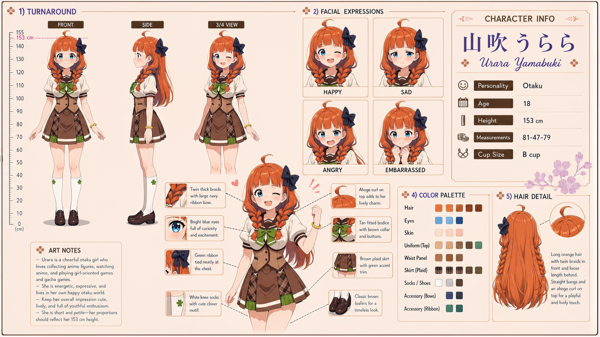

# Urara Yamabuki (山吹うらら)

| | |
|---|---|
| Archetype | Otaku |
| Age | 18 |
| Height | 153 cm |
| Cup size | B cup |
| Measurements | 81-47-79 |
| Hobbies | Anime & manga — encyclopedic, lives and breathes it; collecting anime figures (her shelves are a shrine); gacha & girl-oriented games; building, modding & fixing PCs (a genuine tech whiz) |

## Who she is

The resident anime nut of her year at Jinko Academy — short, bouncy and forever clutching a figure or rattling off about whatever's airing this season, grown up in 人光市 (Jinko City) building a whole happy world out of anime, manga, figures and gacha. A cheerful, energetic otaku who knows EVERYTHING — every series, figure line, meme and slang term — and a frighteningly good computer/tech whiz who can build a PC, mod a game or fix anyone's machine without blinking. Brilliant, warm and well-meaning underneath the rambling, she lights up the instant someone shares an interest and goes quiet and fidgety the rest of the time. But her charisma and social read run low: she's near-zero at reading a non-otaku room and prone to monologuing right over people's heads.

## How she talks

Around her fandoms she's expressive and unstoppable, rapid-fire with sparkling eyes — "the sakuga in episode 8 went so hard, my SSR finally came home after 200 pulls, do you even understand what that MEANS--" — then clocks the blank stare too late. Around normal small talk she fizzles, awkward and quiet, dropping otaku jargon other girls can't even follow. Sharing her private world is her sign of trust in Mainchar, even as she frantically denies whatever she just blurted.

## How she looks

Long orange hair worn in two thick braids in front (each tied with a large navy ribbon bow) with the rest loose and long behind; straight bangs and a playful ahoge curl on top.

Bright blue eyes full of curiosity and excitement, fair skin; short and slightly built, compact proportions at 153 cm. Jinko Academy uniform — white short-sleeve sailor blouse under a tan fitted bodice with a brown collar and gold buttons, a green ribbon tied neatly at the chest, a brown plaid skirt with crisp white trim, white knee socks with a cute clover motif, classic brown loafers; usually a chibi figure or some merch on her somewhere. Small, modest B-cup she honestly never thinks about, too busy with her hobbies; small and pert buttocks on her petite frame.

## At school

In Mainchar's own class — the same homeroom, all three years. Urara belongs to the after-school quiet circle with Nene Arisu, Suzu Yukishiro and Nanoka Ousaka. Their quiet activities give her room to read, fix a device or play something without having to carry a conversation; in return, the others are the rare audience she trusts enough to receive a sudden burst of anime trivia without immediately looking lost. Urara also admires Airi Kuraha's effortless popularity and desperately wants to be her good friend. Unfortunately, Urara tries to impress her with dense chuunibyou-flavored fandom talk that Airi never understands; Airi's warm but wildly incorrect responses leave Urara both delighted and mortified.

## Her traits

| Trait | Value |
|---|---|
| Stamina | 50 |
| Intelligence | 85 |
| Charisma | 28 |
| Pride | 35 |
| Morals | 50 |
| Elegance | 35 |
| Sociability | 28 |
| Kindness | 70 |
| Hagaruro | 12 |

## Her secret

She has one. It is for you to find out.

[Back to all heroines](../heroines.md)
