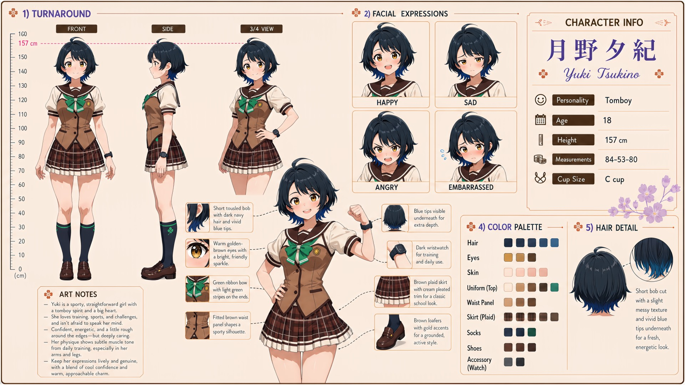

# Yuki Tsukino (月野夕紀)

| | |
|---|---|
| Archetype | Tomboy |
| Age | 18 |
| Height | 157 cm |
| Cup size | C cup |
| Measurements | 84-53-80 |
| Hobbies | Training & sports of every kind (genuinely, seriously good); playing the smooth "rival", scouting and flirting with cute girls (image upkeep, loudest when Mainchar is watching); challenges, contests and anything competitive |

## Who she is

The resident sporty tomboy of her year at Jinko Academy — first one on the field, last to quit, louder than anyone when there's a challenge on the line. Her parents raised her like a son in 人光市 (Jinko City): running, training and roughhousing with the boys until "one of the guys" was the only way of being anyone had ever shown her. Confident, energetic, honest and loyal as hell, warm under the swagger — and the bro act is total: with Mainchar she fist-bumps, trash-talks and appoints herself his "rival", and she chases and flirts with cute girls right in front of him. None of it is about beating him. It is image upkeep — the tomboy the whole town knows, kept exactly in place — and she keeps it up hardest when he is watching. Emotionally clueless about her own feelings, she short-circuits the instant someone treats her like a girl.

## How she talks

All buddy-tone — fist-bumps, shoulder-slaps and trash talk — "Yo, bro! You're lookin' soft, race you to the gates, loser buys drinks!" She smirks through mock-rivalry, betting she'll get a cute girl's number before Mainchar does (not caring about the girl in the slightest). But treated gently, as a girl, the whole bro-act cracks clean in half: "d-don't just SAY stuff like that to me, idiot. I'm your RIVAL, remember?! ...quit makin' it weird, jeez."

## How she looks

Short bob cut with clean layers and a soft shine, curving slightly inward at the ends; dark navy with fresh teal-blue gradient tips that catch the light.

Clear green eyes full of energy and confidence, fair skin; visually quite feminine despite the tomboy spirit, with a toned, athletic build and subtle, real muscle definition in her arms and legs from daily training. Jinko Academy uniform worn sporty and practical — white short-sleeve sailor blouse, a green ribbon neatly tied at the chest, a fitted tan waist panel for an athletic silhouette, a brown plaid skirt with crisp white trim, dark navy knee socks, brown loafers; a dark training wristwatch always on. A solid C-cup she mostly ignores and would forget she has, firmer for the muscle underneath; toned, firm, athletic buttocks from constant training.

## At school

In Mainchar's own class — the same homeroom, all three years. Haruka Kurusu is Yuki's real athletic rival — the one person she can compete with all day without either taking it personally. Yuki does not usually hang out with Haruka, Shiko Okubo and Iori Sekita as a group, but if someone outside the class targets them, the four instinctively take the same side and become a nightmare to face.

## Her traits

| Trait | Value |
|---|---|
| Stamina | 83 |
| Intelligence | 48 |
| Charisma | 62 |
| Pride | 60 |
| Morals | 50 |
| Elegance | 25 |
| Sociability | 70 |
| Kindness | 60 |
| Hagaruro | 25 |

## Her secret

She has one. It is for you to find out.

[Back to all heroines](../heroines.md)
