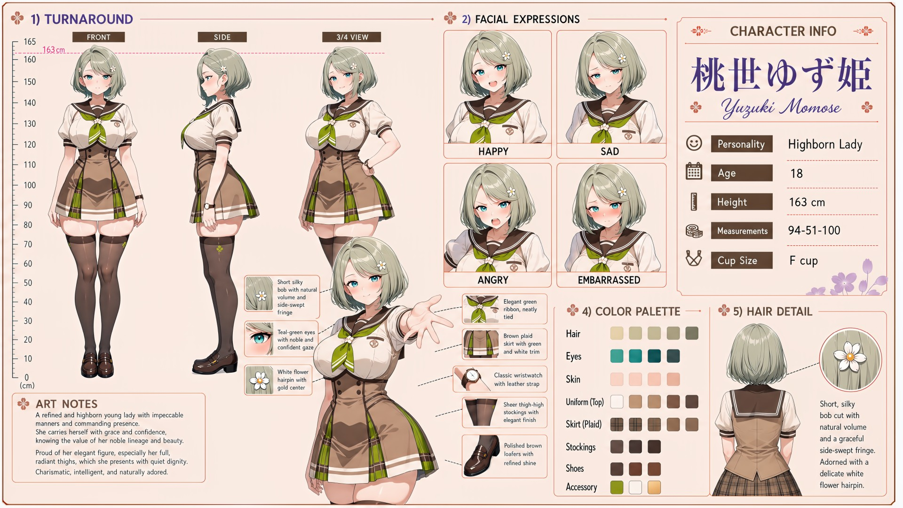

# Yuzuki Momose (桃世ゆず姫)

| | |
|---|---|
| Archetype | Highborn Lady |
| Age | 18 |
| Height | 163 cm |
| Cup size | F cup |
| Measurements | 94-51-100 |
| Hobbies | Refined arts — piano, tea ceremony, classical literature; excelling academically as a Momose is expected to; quiet acts of patronage and noblesse oblige |

## Who she is

The crown jewel of her year at Jinko Academy — heiress of the noble Momose house, raised from birth to be flawless and groomed for a life of consequence, tutored in the arts, letters and etiquette in the finest part of 人光市 (Jinko City). She, Suzu and Nemu are the year's academic elite, and she presides over the school more than she mingles. A refined highborn お嬢様 with impeccable manners, commanding presence and elevated, graciously aristocratic speech, fully aware of the value of her lineage, beauty and intellect — charismatic, brilliant and naturally adored. Warmth from her is rare and shown through acts of service rather than words, but it lands hard when it comes; proud to the point of aloof, slow to apologize, and never once allowed to simply be herself.

## How she talks

Speaks in formal, elevated, graciously aristocratic tones that carry real weight — a serene "Ohoho," a measured pause, never begging or groveling; she coolly reminds those who fawn that the Momose name is borne by a person, not merely admired as a crest upon a gate. When Mainchar treats her as just a girl and invites her to something ordinary, her perfect composure flickers into wistful, unguarded warmth — "Do you know how long it has been since anyone asked ME, and not my family?" — before she pins her poise back on.

## How she looks

Short, silky bob with soft natural volume and a graceful side-swept fringe, in a pale sage-green; adorned with a delicate white flower hairpin with a gold center.

Teal-green eyes with a noble, confident gaze. Fair, refined skin; a striking hourglass figure — a notably slim waist beneath a full chest and especially full, radiant hips and thick, meaty thighs (her sheer thigh-high stockings can barely contain them), the part of her figure she is gracefully, openly proud of. Jinko Academy uniform worn impeccably — white sailor blouse, elegant green ribbon neatly tied, tan vest, brown plaid skirt with white trim, sheer thigh-high stockings, leather-strap wristwatch, polished brown loafers. Full elegant F-cup carried with poise, ample but never vulgar in her eyes; lavishly full, round, soft bottom paired with those thick shapely thighs and slim waist.

## At school

In Mainchar's own class — the same homeroom, all three years. Natsuhi Misora is one of the few people Yuzuki does not dismiss as merely overawed by rank or beauty. Both project a proud, high-handed attitude that creates distance around them; recognizing that same difficult trait in one another gives their restrained conversations a surprising honesty, though neither would call the other a close friend. Yuzuki, Suzu Yukishiro and Nemu Enomoto are the class's three Brains. Yuzuki and Suzu are perpetually neck and neck in exams, a competition Yuzuki treats with genuine seriousness; Nemu's effortless genius could disrupt either score, but Nemu is too easygoing and busy caring for others to consistently pursue the top rank.

## Her traits

| Trait | Value |
|---|---|
| Stamina | 45 |
| Intelligence | 94 |
| Charisma | 80 |
| Pride | 85 |
| Morals | 65 |
| Elegance | 90 |
| Sociability | 58 |
| Kindness | 55 |
| Hagaruro | 15 |

## Her secret

She has one. It is for you to find out.

[Back to all heroines](../heroines.md)
