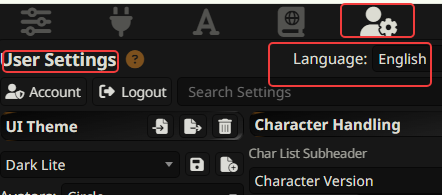
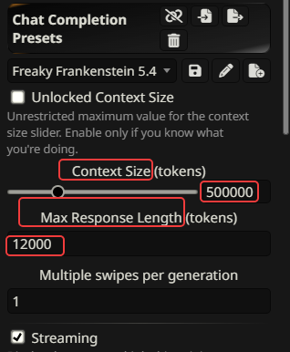
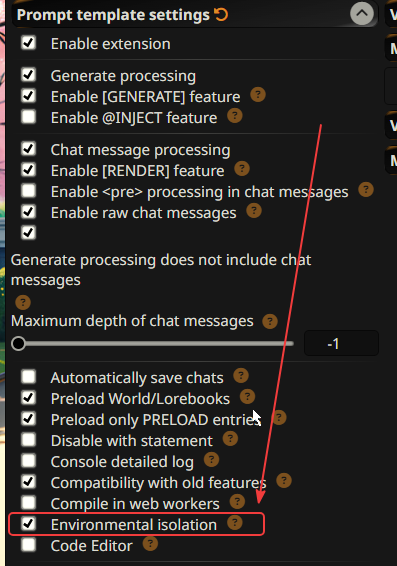
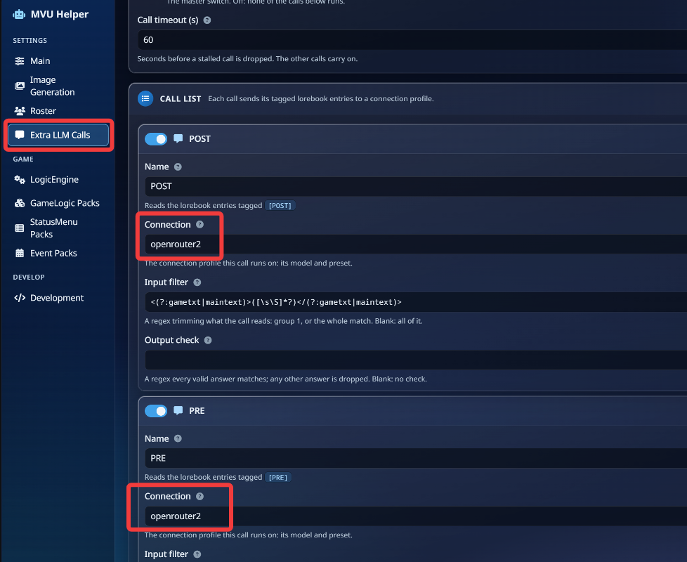
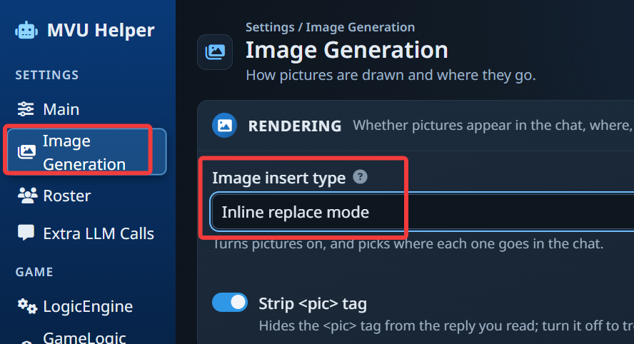
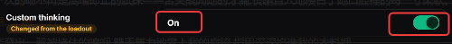
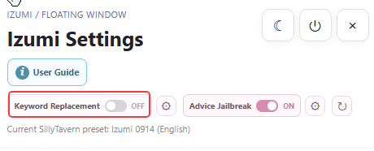

# Install ArtificKoi

ArtificKoi runs on MVU Helper, and MVU Helper rides on 2 other SillyTavern extensions, Tavern Helper and ST-Prompt-Template. So you install those 2 first, then MVU Helper, then the card. It takes about 5 minutes.

## 1. Switch SillyTavern to English

SillyTavern > User Settings > Language > **English**.

My docs use the English name for every menu and every setting. With SillyTavern in English, what you see on screen matches what you read here.



## 2. Set a big context size

SillyTavern > AI Response Configuration > in your [preset](requirements.md#preset), set **Context Size** to something big, and **Max Response Length** to 12,000.

The game doesn't use that much context. But there's code inside the lorebook entries, and SillyTavern thinks that code gets sent to the AI model too. It doesn't. The code is never sent to the AI model at all.



## 3. Install Tavern Helper

SillyTavern > Extensions > Install extension. Paste this link, and click Install:

```
https://github.com/N0VI028/JS-Slash-Runner
```

## 4. Install ST-Prompt-Template

Same place. SillyTavern > Extensions > Install extension. Paste this link, and click Install:

```
https://github.com/zonde306/ST-Prompt-Template
```

## 5. Turn on Environmental isolation

This one is VERY important. Don't skip it.

SillyTavern > Extensions > Prompt template settings > tick **Environmental isolation**. It's near the bottom of the list.

A lorebook entry with EJS is JavaScript running on your SillyTavern page. With isolation on, it runs in a sandbox that refuses network requests. It's off by default, so turn it on before you load any card. It needs ST-Prompt-Template 1.17.8.2 or later.



## 6. Install MVU Helper

Same place again. SillyTavern > Extensions > Install extension. Paste this link, and click Install:

```
https://github.com/KritBlade/mvu-helper
```

## 7. Let MVU Helper install MVU

The first time MVU Helper loads, it asks "Install MVU now?". Click **Install**. It adds MVU as a global Tavern Helper script, so every MVU card can use it.

If you said no, that's fine. MVU Helper > Main tab > **Install MVU** does the same thing later. Until MVU is installed, every game feature stays off.

## 8. Download and import ArtificKoi

Download the card, [ArtificKoi.png](../dist/ArtificKoi.png). On its GitHub page, click the download button at the top right.

Then SillyTavern > Character Management > **Import Character from File**, and pick `ArtificKoi.png`.

SillyTavern then asks whether to import the card's embedded World/Lorebook. Click **Yes**. That lorebook is the game itself, and ArtificKoi can't run without it. If it asks to allow the card's scripts or regex too, say yes to those as well.  
  
**RELOAD chrome once by pressing F5 after you go into the chat, sometimes galgame GUI won't launch and it's a bug in galgame that I can't fix.**

## 9. Pick a connection for PRE and POST

ArtificKoi runs 2 extra LLM calls every reply, [PRE and POST](requirements.md#the-pre-and-post-calls). Both need a connection.

First, make a new connection profile in SillyTavern's Connection Manager. For an API model, I recommend GPT 6 Luna. It's fast and cheap, and these 2 calls run every single reply.  Make sure when you create new connection, use a preset that is known to JB correctly or the picture drawn will not be explict.  You can use  [Megumin](https://github.com/Arif-salah/Megumin-Suite) , [Freaky Frankenstein](https://www.reddit.com/r/SillyTavernAI/comments/1w49lyx/preset_update_freaky_frankenstein_54_the_second/)  and both should work, just turn off all logic and prose related stuff in preset as you don't need all that in PRE and POST.

Then MVU Helper > **Extra LLM Calls** > set the **Connection** on both PRE and POST to that profile.

On a local model? Pick the same model you play with. Switching models takes time, so you might be better off just use the same model.



## 10. Turn on image generation

[Image generation](requirements.md#image-generation) is off by default. If you already set it up, you have to turn it on in MVU Helper.

Open ArtificKoi's chat first. Then MVU Helper > **Image Generation** > set **Image insert type** to **Inline replace mode**. The setting belongs to the card, so every card keeps its own.  If you are using local model, you might consider to change "Picture written by" to POST if you see image from time to time not drawing.

Didn't set up image generation? Skip this step. The game plays just fine without pictures.



## 11. Set up your preset

ArtificKoi needs the AI model to think before it writes. Besides the story, it has to trigger events, change outfits and write the command for a picture, all in the same reply. Without thinking, the model starts forgetting some of them.

In [Megumin](requirements.md#preset), turn **Custom thinking** on.



Using another preset? If it has a switch that turns thinking off, make sure it's on.

On [Izumi](requirements.md#preset), there's 1 more switch. In the Izumi Settings window, turn **Keyword Replacement** off. It swaps keywords in every prompt and in the chat history, and the game needs its own words to reach the AI exactly as written.



That's it. Open ArtificKoi's chat and start playing. What each of these extensions does is on [What is Tavern Helper, ST-Prompt-Template and MVU](https://github.com/KritBlade/mvu-helper/blob/main/doc/st_extensions/README.md).

[Back to index](../README.md)
