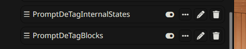
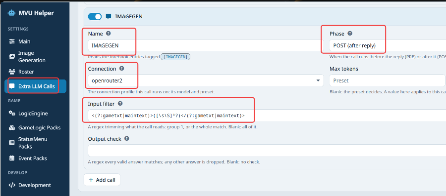
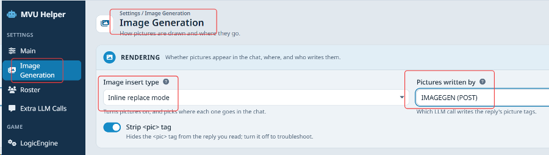
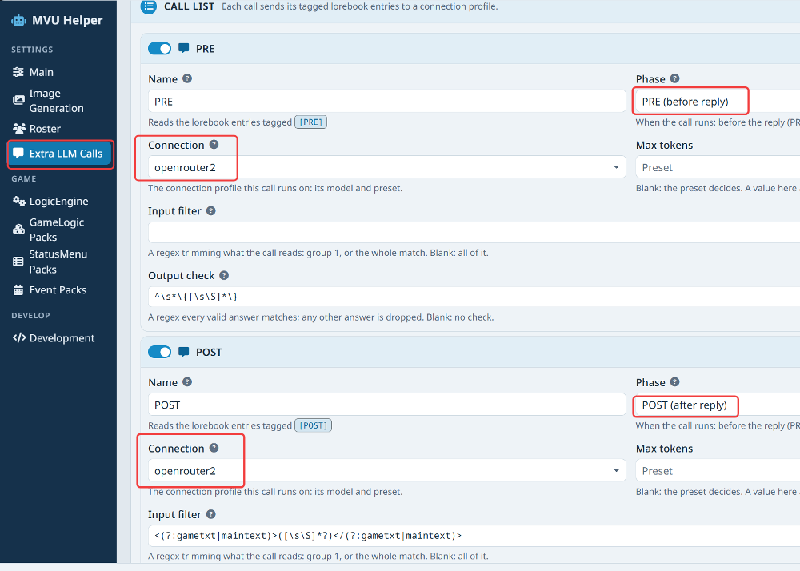
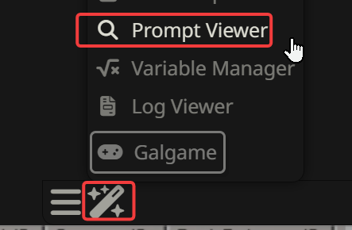
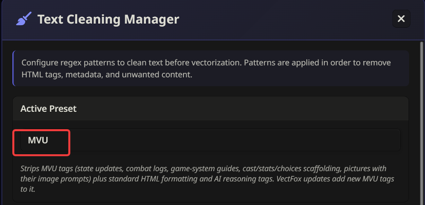
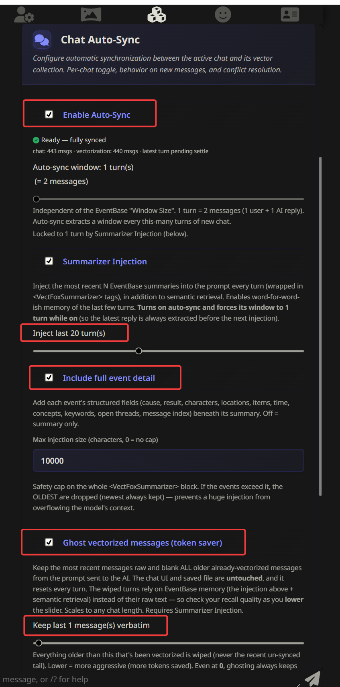

# ArtificKoi requirements

Artifickoi is built on top of MVU Game Engine v2.0.  Unlike regular Sillytavern card that rely on prosing, the game engine make use of agentic AI model for instruction execution.  The smarter the model, the better the gameplay is.

## Preset

Any preset works for an API model. That includes the popular ones like [Megumin](https://github.com/Arif-salah/Megumin-Suite) , [Izumi](https://discord.gg/C6HabNwzn7), [Freaky Frankenstein](https://www.reddit.com/r/SillyTavernAI/comments/1w49lyx/preset_update_freaky_frankenstein_54_the_second/) and [FF micro](https://www.reddit.com/r/SillyTavernAI/comments/1u2wrvq/preset_introducing_freaky_frankenstein_micro_my/) . Even something as simple as SillyTavern's plain "Default" preset works.

For a local model, I recommend Megumin. It tends to work better, and the model misses fewer instructions with it. Also, always set the thinking effort to high on a local model. That makes up for some of the [IQ gap between a local model and an API model](../Image/Readme/intelligence_index.png).

No matter which preset you use, turn off everything in it that's about game logic and stat tracking:

- **Freaky Frankenstein:** NPC Instincts+vad_emotion, DnD Simulator, Inventory, Feats, Titles and Relationships RPG, Internal Agenda, World Sim, Chekhov's Gun, Internal Thoughts.
- **Megumin:** Dice, Bonds, World State,  Death system and Combat system.
- **Izumi:** Since Izumi have no game logic change, it works as is.

Basically, anything that changes how the system behaves in the chat goes off.  Tracking feature can be turned on if you like but at the cost of a lot more tokens ,  our status menu should have every single stats you want to look at anyway.  So, turning those off can save a lot of token as well.  The game engine already has all of the features from preset coded in the backend. You don't need a second layer on top of it, and you don't need to send those instructions to the AI like what the preset does.  

Moreover, **any tracking feature from preset or extension** that show the name of the classmate will trigger Sillytavern to send the lorebook character entry of that classmate to AI model.  Therefore, if a tracking feature in the preset that record all 21 classmates and display her name and unofficial stats inside the chat, it will trigger Sillytavern to send the complete profile in lorebook for all 21 classmates ( 30000 token total) regardless if she is on stage or not.  The MVU use a completely different approach that we do tracking without appending all these information inside the chat to save token.    I have muted that information send to AI model by default, but you can turn it off if you want those information from preset at the cost of token.  I didn't make regex to muted those output to AI on every single tracking preset/extension out there, so if you use any tracking preset/extension, you will have to make your own regex to mute those information send to AI.    Under normal circumstances, you don't need tracking extension when you are using MVU.  **MVU do NOT append stats and state of characters in the chat**, that's why our game logic engine do not have the same problem as other tracking extension.



The tracking and game logic change in preset/extension don't do anything here anyway. Say a preset rule tells the AI to raise Mitsuki's Affection because you were nice to her. The engine checks who has the authority to change Affection, a preset rule doesn't, so the change is never made. With those features on, you just pay tokens for instructions that never land.  That means any DC dice roll done by preset, it will not be registered at all because back end coding will cross check the result.  Same goes any preset/extension that does stat tracking, it would not show the correct information until it is made to become MVU compatible.   

Personally, I only turn on the features that change the prose style.

## Image generation

Image generation is optional, but this is what it takes.  That means you CAN play without image generation.

You need a working ComfyUI installation. New to ComfyUI? Start with my [ComfyUI setup guide](https://github.com/KritBlade/mvu-helper/blob/main/doc/image_gen/comfyui_setup.md).

You need a video card with 6GB of VRAM or more, and I recommend 12GB or more. That card is busy drawing the pictures, so the story has to come from an API model. The only way around it is 2 beefy PCs at home, one for the pictures and one for the story.

### Narrate or a separate POST call

Somebody has to write the picture tags. You can leave it to narrate, or hand it to a separate small POST call.

Narrate is the default. Narrate is the main call, the one that writes the story, and it writes the picture tags as it goes. So a picture starts drawing while the reply is still streaming in. That's the fastest way, and a large API model handles it just fine.

A local model is a different story. Narrate already has to write the story, trigger the events and change the outfits, all in 1 single call. Some local models can't keep that many instructions in mind, and they just forget to print the picture.

A separate POST call is the fix. It runs after the reply, reads the finished story, and its ONLY job is the pictures. The price is speed: no picture can start until the reply is done and the POST call answers.  It does have 1 advantage using a separate POST for handling image generation and roster harvesting, it save quite a bit of token from main narrate call.  PRE and POST usually use smaller and cheaper model so cost saving can be big in a long run.

First, add the call. MVU Helper > **Extra LLM Calls** > **Add call**. Name it something like IMAGEGEN, set **Phase** to POST (after reply), and pick a **Connection**. A small, cheap model is fine here, it only does 1 thing. Then set the **Input filter** to this, so it reads only the story:

```
<(?:gametxt|maintext)>([\s\S]*?)</(?:gametxt|maintext)>
```



Then hand the pictures to it. MVU Helper > **Image Generation** > set **Pictures written by** to IMAGEGEN (POST). Do the same on the **Roster** tab: set **Harvest via** to IMAGEGEN, so the looks of new characters come from the same call.



So, in short: a large API model, leave it on narrate for fast pictures. A local model that forgets the pictures, give them to IMAGEGEN.

## The AI model

The smallest local model that works is Gemma 31B. It does forget to trigger an event from time to time.  Gemma4 31B prose great, but it is [dumb](../Image/Readme/intelligence_index.png).

I spent a lot of time testing on local model.  In general, they are dumb.  For a local model, I recommend **Qwen 3.8 27B**, it's an agentic model so it smart enough to work with a game engine, however, it doesn't prose as good as Gemma4.  Since most video card can't host more than 1 local model without switching, you might as well just assign PRE and POST on the same model.   **For local model, always change the thinking effort to high for Gemma 31B and medium for Qwen 27B in the preset**.  This is the only thing that can keep local model writing correct command to draw the picture and trigger event correctly.  If you see local model thinking less than 1 minute, you should expect you will have missing event trigger or missing picture not drawn.  This is not something I can fix due to the lower IQ of local model.

Small MoE like Gemma4 26B A4B models don't work consistently enough to be useable. Besides writing the story, the AI has to write a proper command to draw a picture in ComfyUI, trigger events at the right time, changing outfit at the right place and a MoE model just isn't smart enough to do all these together.  Sorry for all the Gemma4 26B A4B lovers out there,  I have tried but it's just too dumb.  As soon as trying to throw the model with some instructions other than prosing, it will forget stuff like a goldfish.

My recommended setup is an API model for the story: **Gemini Flash 3.8, Gemini 4 Argon, Kimi 3 , GLM 5.3, Sonnet 4.6 or above, or Opus** or any newer version of these for main narrate model.  GLM 5.3 Flash works OK, but sometimes it forgets to draw the picture, and it tend to write very short reply.  GLM 5.3 flash works better with preset Freaky Frankenstein 5.4.  Mimo 2.6 Pro works if you have the correct preset, you will need a preset that do the thinking for about 1-2 minutes in order to work correctly.  Deepseek 4 and Deepseek 4 flash might forget to trigger event or draw picture.  Almost all preset maker would tell you this, Deepseek 4 is not good at following instruction, and MVU Game Engine v2.0 rely model to execute instruction, not prosing.   For PRE and POST, I highly recommend **GPT 6 Luna**, because its fast and very cheap.

## The PRE and POST calls

ArtificKoi runs 2 extra calls every reply, besides the main one that writes the story. PRE runs before the reply, and POST runs after it.

They take work off the main call, which is the expensive one. PRE rolls the checks and gets the instructions ready before the story is written. POST reads the finished reply and reports back what happened in it.

You have to pick a connection profile for each of them. MVU Helper > **Extra LLM Calls** > set the **Connection** on both PRE and POST.

Pick a model that is smart enough, but cheap and fast, like GPT 6 Luna. They run every single reply, so a pricey model here adds up fast.



How these calls work is on [Extra LLM Calls](https://github.com/KritBlade/mvu-helper/blob/main/doc/extra_llm_calls/README.md).

## SillyTavern settings

Please set the output length to no less than 600 words, because a lot of events are a long story.

Set the context size to 300,000 and the max response length to 15,000. The game won't really use that many tokens. SillyTavern just doesn't know there's code inside the lorebook, so it expects way more tokens than will really be sent.

## Checking your token use

A prompt inspector that estimates your token use most likely shows the wrong number. It counts all the code in the lorebook as if it goes to the AI, and it doesn't.

The accurate way is the Prompt Viewer, in the magic wand menu. The upper left shows the tokens that will really be sent.



## A memory extension

I **highly recommend** a memory extension that hide (ghosts) ALL the history except the very last reply. Use my other project [VectFox](https://github.com/KritBlade/VectFox), or [Summaryception](https://github.com/Lodactio/Extension-Summaryception).  It makes a HUGE difference in the thinking process if AI model only need to digest 60000 tokens or less for local model.  API models would also benefit for better instruction following.

In VectFox, turn on Enable Auto-Sync and Summarizer Injection, and inject the last 20 turns of summary. Turn on Include full event detail. Then turn on Ghost vectorized messages, and keep the last 1 message verbatim.

Then VectFox > **Action** tab > **Text Cleaning**. Set **Active Preset** to **MVU**, and click **Save Changes**. It strips the game's own tags, like state updates and picture prompts, before VectFox reads the story.





For reference, my own story at floor 440 sends about 46,800 tokens a reply on Gemini 4 Argon. That already includes image generation on POST, every event trigger and the full summary of the last 20 replies.

[Back to index](../README.md)